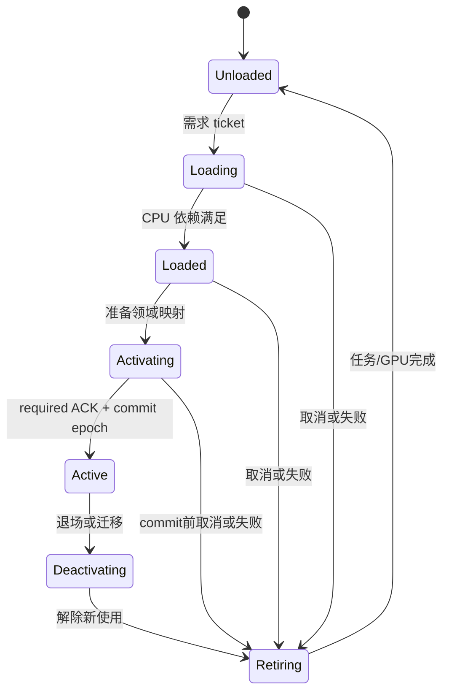

# 371-B 规模基础贯通设计

## 0. 位置与状态

- 日期：2026-10-09；方案 B 已选择，本文为 S0/S1 的设计细化，状态 `design_documented`。
- 上游：[总合同](371-大型游戏级AI原生3D平台-方案B-v1总合同.md)、[总方案](371-大型游戏级AI原生3D平台-方案B-v1方案.md)。数值负载、测量与预算只由 [A](371-A-规模基准与资格矩阵.md)定义；来源依据见 [C](371-C-成熟引擎源码依据.md)，待决策责任见 [D](371-D-方案自审与决策记录.md)。
- 本文没有代码施工命令，不是施工文档，不占当前/待执行槽。F0–F7 是后续实现时要证明的设计单元，当前没有任何 F 项获得通过资格。

## 1. 基础贯通的结果

S1 结束时，一个普通项目经现有 Compiler 生成 RuntimePackage，由同一 Player/DLL 完成：

```text
真实静态模型/材质 + 版本化空间/世界配置
  → 当前 World 和两个已提交模拟 snapshot
  → 仅变化部分的 Projection
  → 持久渲染实例 + 真实多视图
  → 按 phase 批次 + 资源依赖计划
  → 复用 GPU 资源、批量/分段上传和实际 completion 退休

真实 cooked cell 资源
  → 后台 I/O/decode → 预算调度 → CPU/GPU 分域就绪
  → 激活事务 → 整个已提交 epoch 可见
  → 请求取消/迁移/退场 → 在途任务和 GPU 安全释放
```

必须包含多数对象不变、稀疏变化、全动态、重复资源、多种资源、相机移动、不同视图、取消/重载/销毁等情况。旧 2D/AUI 与静态 3D 必须继续通过受影响组合。

S1 的生产 cell consumer 是真实 World/Asset/Renderer。Physics/Nav 在 S0 做真实库空间适配探针，但产品接入在 S3；S1 不借替身或模拟 ACK 宣称完整跨区物理/导航。S3 接上后必须重验同一生命周期。

## 2. 实现前基线与决策

### F0：冻结可比输入

后续开始实现时，记录实际工作区/依赖、引擎和项目二进制、包内容、驱动/API、profile 与平台身份，不能把当前 dirty 工作区的 Git HEAD 当作唯一源码身份。

建立普通 benchmark 项目、fixture 生成器、确定输入/相机轨迹和报告接口设计。先在旧路径得到允许失败的 baseline，保留失败/超时首因；不能为了 baseline 通过而改小目标负载。小负载 fail-fast 后再扩大，避免连续高成本窗口诊断。

S0 必须先完成：

1. 固定空间坐标/误差与 origin epoch 合同，实际版本/consumer 迁移矩阵。
2. 物理与导航首期后端/版本、精度/形状/tile/线程/目标构建能力，以及最小真实库探针。
3. 首期渲染路径、需要的 backend feature、已选择的 ViewDepthPolicy 默认、clear/compare/clip/投影重建与旧 U2 映射、资源访问语义；S2 内部效果参数可后续冻结。
4. 有界队列、最大在途帧、内存/上传/退休预算的测量方式与配置。
5. PC 固定测量机、Android 真实设备子档及缺设备时的阻塞项；设备未验不得填通过。

S0渲染选择按A§3.1限定技术探针与参考证据，不要求提前建设S2。生成器/目标配方先冻结，尚无consumer的Cook布局和摘要在所属阶段首次运行前冻结；不可用产物保持not_executed。

目标构建前置须显式盘点：当前Headless Compiler的check/build拒绝WindowsRelease和Android，已有WindowsDev不能代替正式Release测量；旧Android逻辑位于`editor_core/src/android_export.rs`。S1须将PC Release与最小Android构建接到既有Compiler/Build的SourceView及唯一Assembler，不能绕经Editor/live project_root；S0暂缺Release产品基线可记未可用，不能用dev数据授予Release资格。

当前Android仅有Dev目标，S1还需新增正式Release/优化target及profile消费，并验证实际Module/engine/包均为目标配置。只打通AndroidDev不满足A的Release基准前置。

真实库探针至少包含：同一局部几何置于近原点/远锚点的误差比较、角色/刚体或查询跨锚点连续移动、两个相邻 nav tile 的路径与卸载失效。不得使用假 body/nav tile 实现消除该前置。

### 2.1 推荐修改 owner

| 链路 | 当前源码锚点 | 实现方向 |
| --- | --- | --- |
| 空间/意图提交 | `world.rs`、`spatial_3d.rs`、`project_runtime_session/spatial.rs`、SDK spatial | 批量校验/提交、no-op、版本/锚点与 dirty 合并 |
| 提取与生产准备 | `render_projection_adapter/spatial.rs`、`render_geometry/production.rs` | 预编译身份/绑定、持久 item store、变化集与移除 |
| 几何与图 | `render_geometry.rs`、`render_geometry/graph.rs`、`render_graph.rs` | view/phase/batch 与资源访问计划 |
| 提交与资源 | `render_thread*.rs`、`render_resource.rs`、`rhi_command_plan.rs`、`wgpu_backend/real/geometry.rs` | 有界 packet、frame arena、实际 GPU fence 与退休 |
| 加载与包 | `runtime_asset_loader.rs`、`runtime_asset.rs`、Compiler/Assembler | 异步任务、共享请求、分域 ready、cell cooked 描述 |
| 观察与项目 | 既有 runtime observe/playtest、AI Development Pack | 必要计数、错误定位、可执行普通项目例子 |

表中路径相对于 `rust/crates/engine_runtime/src`，SDK/Compiler 除外。它描述现有 owner，不要求把逻辑堆进单文件；具体分解在实施前按代码职责确定。

## 3. 基础数据合同

以下是拟定类型及字段语义，具体 Rust/wire 布局由 S0 consumer 矩阵冻结。序列化创作描述与紧凑运行数据分开；日志 schema 不直接成为热循环容器。

| 数据 | 必备语义 |
| --- | --- |
| WorldPosition / WorldAnchor | 高精度定位、所属 world/anchor、版本；local transform 与其组合关系 |
| CommittedSimulationSnapshot | world epoch、tick、已提交空间/必要姿态、结构版本；不可变可共享 |
| PresentationPose | tick pair、alpha、presentation frame、origin epoch、表现矩阵/bounds；不回写模拟 |
| SpatialDeltaBatch | world/tick/transaction、create/update/remove、field mask、source→runtime 映射 |
| PresentationDelta | 表现版本、活跃插值对象、alpha/视觉姿态/origin变更；与模拟dirty分开计数 |
| PersistentEntityRef | world persistent ID、placement/spawn instance ID、entity local ID；区别于原型来源和一次运行handle |
| RenderInstanceRecord | instance+generation、entity handle、prepared mesh/submesh/material、bounds/layers、版本与 GPU slot |
| PreparedBindingKey | 紧凑资源 identity/version、layout/pipeline variant；在变化时建立 |
| ViewState | camera/viewport/target、独立 origin、view/history epoch、可见性依赖 |
| ResourceLease | 资源版本、消费者、domain、最低质量、预算类别与有效期 |
| RequestTicket | 消费者 request generation、取消态、world/cell/target revision、shared operation 引用 |
| SharedLoadOperation | 资源版本/domain 的去重 key、I/O/decode/upload 进度、活跃订阅集合 |
| ActivationTransaction | cell generation、activation epoch、required domain mask、ACK、prepared mapping、commit/abort |
| FramePacket / Submission | packet/frame/scene epoch、device epoch、不可变 payload、所持资源、完成 token |

设计目标是一次建立稳定关联并按变化维护。来源路径/命名字符串允许在创作、prepare、错误和观察边界出现；每帧不再全量计算身份 hash/JSON key。

## 4. F1：空间提交与表现插值

### 4.1 变更处理

1. SDK 意图先保留调用顺序及事务归属，验证句柄/world epoch、数值/模式和组件能力。
2. 在合法阶段合并可合并更新；结构变化、材质/mesh 替换、create/destroy 保留顺序依赖。
3. 批量验证后的提交生成 field-specific dirty mask；未变值不创建下游更新。
4. 合并层级 dirty roots，避免同一子树反复递归；更新 local/world/bounds 所需版本。
5. 生成新增/变化/删除集合，分别通知需要的领域 adapter；不让某一个消费者独占并吞掉其它领域必须知道的变化。

错误采用合同固定的事务失败规则。一个失败 batch 不留下已修改半个 hierarchy；非事务 API 若允许逐项接受，结果必须明确每项状态，不能和原子 API 混用。

### 4.2 模拟与呈现

固定 tick 的 World 产生已提交 snapshot；呈现从两个完成态计算 alpha。零个新 tick、多个 catch-up tick、暂停/单步/teleport 都要有确定结果。teleport 或 mode/anchor 切换时清楚决定是否重置历史，不能插值穿过整张地图。

PresentationPose 保存在表现域，永不回写 Transform3D/PhysicsBody。pure visual IK 后的 render bounds 可以扩大；游戏命中/挂点查询只消费其声明的模拟姿态。renderer 只取得不可变输入。

观察须能同时看到模拟位置与实际呈现位置，并标明 tick/frame，而不是把二者混成一个 transform。

表现版本独立于模拟版本：60 Hz模拟配120 Hz呈现时，零新tick仍可能有不同alpha。既有Projection/表现owner生成PresentationDelta，只更新活跃插值对象及相关bounds/上传；结构/资源变化继续原统一通道。静态零dirty负载不能混入正在插值的对象，也不能把正常表现上传算成全场无效重建。

## 5. F2：持久实例、视图与批次

### 5.1 常驻表与更新

既有 RenderScene 持有实例表，资源准备缓存按实际绑定变化更新。首次建表、变更、删除和资源版本替换产生紧凑 patch。相机移动只触发相应可见性/排序，不重新准备全部 mesh/material。

CPU 表和 GPU slot 可有不同布局，但映射必须有 generation。删除先标记该 incarnation 不再进入新可见集合，在途包继续持有旧资源；跨资源/在途引用的slot只有满足实际提交完成后才能复用；同一固定buffer的内容slot允许采用下段严格有序上传，旧提交读→新写→新提交读受同queue顺序保障，不用CPU帧号伪造completion。

GPU instance buffer 采用分配上限明确的 arena/页或 ring。稀疏变化上传 ranges，全动态时可选整页上传；阈值由测量确定。buffer 扩容、compaction 和材质重分桶均产生显式版本与计数，不能藏在每帧无界重建中。

FramePacket同时固定buffer/range/content version。更新已有slot也不得改写旧packet所需内容；可用frame slot/COW，或保证旧读→新写→新读的submission上传顺序。慢worker、延迟GPU和连续改变同一实例/材质/插值alpha的组合须核对真实画面与各packet snapshot，不只检查对象未销毁。

#### 5.1.1 已确认的驻留几何页与独立范围（2026-10-13）

用户确认BM03资源数量成本修复，native mesh物理存储改为现有GeometryGpuState内有界vertex/index页和独立range。每个mesh继续独特source/handle/generation；页共用不改变逻辑字节、draw/实例或兼容合批语义。完整请求先以checked对齐/范围/设备上限/物理预算预规划，失败不得修改旧驻留内容。物理page/padding/在途尚未归还range的页必须计费；snapshot分别表述逻辑mesh与实际物理页字节，不能把逻辑字节当作物理总量。

释放/替换mesh先按原bundle失效路径解除新帧消费；原retire_gpu/completion owner持有退役range至真实完成，然后归还空闲段，可合并邻段。共用页不因释放一个mesh而销毁；所有live/在途range归还后空页才可释放。页引用/计费只留在原资源owner，没有第二fence ledger。cell pin、同handle冲突、代际及device abandon/shutdown继续原生命周期；范围复用不消费CPU帧号假完成。独特mesh范围对齐、索引格式、first_index/base_vertex与instance slot必须真实GPU验证，不通过同几何替换原unique负载。indirect/GPU culling不作为本块前置。


静态直传保留既有设备单buffer上限与有界页数，不把流式默认256MiB反向变成静态总资源上限；显式set_geometry_upload_budget或活跃streaming pins下，两入口共享该物理驻留预算。流式默认数值保持，静态原BM配方与正式进程内存预算保持；pool按4MiB目标页、4096页上限规划，小请求按实际对齐需求收缩，单大mesh可到设备buffer上限。预算只证明tracked buffer/texture bytes，不包括driver内部对齐或完整VRAM。

### 5.2 可见性与排序

空间索引消费 dirty bounds；每 view 的可见集合独立。CPU 路径先成为正确性基准，随后 GPU preprocessing/indirect 对照相同候选与剔除语义。

S1-C新增原生UnlitFlat材质变体：项目侧`MaterialAssetV2.ignoreVertexColor`与`CookedMaterial.ignoreVertexColor`可选bool，缺省false保持既有顶点色乘法；true时真实shader忽略COLOR_0，进入独立pipeline identity，不只是改名或报告。沿既有项目material-asset.v2→Compiler→CookedMaterial→PreparedGeometry→DrawGeometry→wgpu贯通；该S1记录当时尚无高层glTF MASK/PBR；2026-10-15的S2-A已贯通MASK/PBR/mip，实际语义、256字节参数布局和资格边界见[材质合同](371-S2-A-材质与采样实际合同.md)。

opaque/mask 按管线/材质/mesh/布局兼容键分桶，透明按其排序规则；视图不同不串用实例范围。多个兼容 draw 共用 render pass。一个 draw/pass 的数量必须由实际后端统计验证，不能只看高层计划声称合批。

多视图至少验证两个相机/离屏 view 的不同可见集合与 resize，主视图/AUI 组合正常。shadow view 在 S2 接入，并复用同一 view/lifetime 接缝。

## 6. F3：资源依赖图、提交和退休

### 6.1 图编译最小完整链

输入包含 typed resource ID、view、pass access、attachment、尺寸/格式/采样数、external/persistent/transient/history。构建依赖时区分显式前后约束与资源访问先后，不依赖资源字符串按字母排序。

编译结果包括：合法拓扑、活跃 pass、资源开始/结束使用点、临时资源兼容复用、history 更新、backend capability 与紧凑执行计划。相同图结构可以复用编译结果，只 patch 本帧 handle/view 参数；结构/格式/feature 变化才失效。

错误必须在提交前指出未初始化读取、非法 feedback、读写冲突、缺失输出/资源、循环、格式/尺寸/采样数不匹配。不使用“发生任意错误则退回测试三角形”的路径。

wgpu 内部负责其 API 所需同步；Engine 的计划仍保存中立访问关系。S1 不要求多 queue/async compute，但不能把缺少 barrier API 操作误称没有资源同步责任。

### 6.2 CPU/GPU 交接

```text
World commit E
  → 不可变 FramePacket(E,F,DeviceEpoch)
  → Render worker accepted
  → 编译/编码完成
  → RHI submission S
  → GPU completion(S)
  → 释放 S 最后使用的旧资源/slot

Present(F) 单独计时/记录，不代替 GPU completion，也不由 CPU submit 推断。
```

bounded queue 的可靠命令不能被无声丢弃。packet 持有的 lease 在 GPU 尚未完成时有效；销毁实体不等于可以释放其最后一帧引用。

任何等待不得持有推进完成所需锁/World 写权限。关闭、最小化、resize 与异常必须能打破合法取消边，不能无限等待平台事件线程自己驱动的回调。

### 6.3 设备丢失

正常 retirement 与 device-lost abandonment 分开。丢设备时终结旧 DeviceEpoch，禁止再向旧设备上传/发布就绪；backend 销毁/确认失效后回收其 GPU 分配。不能以等待超时冒充正常 GPU 完成。

恢复时只从仍有效 cooked/CPU lease 重建当前需求资源；旧 epoch callback 不得把旧 handle 插入新设备表。是否支持自动恢复或明确退出，由目标 profile 冻结，两种都必须有有界清理结果。

## 7. F4：真实异步资源与预算

### 7.1 工作与订阅分离

```text
Cell A ticket ─┐
               ├→ SharedLoadOperation(mesh, version, domain)
Cell B ticket ─┘    → IO → decode → CPU ready → upload → GPU ready

取消 A：解除 A 的发布资格和 lease；B 的请求继续。
取消最后消费者：按缓存/预算策略取消或完成到有界缓存；不恢复旧 ticket。
```

后台任务只读不可变包索引/字节和自身数据，不访问可变 World。完成通知带完整 epoch/version；主 owner 校验后接入 CPU/GPU 表。

去重不等于所有消费者共用一个取消位。资源任务完成与 cell 激活是两个事务：资源可以成功缓存，而已取消 cell 必须保持不可见。

### 7.2 预算调度

控制 I/O 请求与字节、decode scratch、CPU resident、GPU resident、staging、每帧 upload 和 retired-but-in-flight。优先级按需求与 deadline、滞回规则调度，避免低优先任务饥饿或高优先请求无限挤占。

必要资源超预算时返回明确 admission failure 或等待策略；可选 mip/LOD 按 profile 降级。一个不可分割资产大于上限时应明确拒绝，或在 Cook 改成可分块格式，不用每帧例外破坏预算。

Counter 必须区分 requested/allocated/resident/in-flight/retiring/released；CPU 缓存不等于 GPU 驻留。测试只对已跟踪内存和明确 RSS/driver 观测范围作结论。

## 8. F5：最小分区事务

### 8.1 Prepare/ACK/Commit



状态转换保存 target-state revision。Prepare 中实体可以有保留槽，但不被 gameplay query/事件看见。所有 required domain ACK 后统一发布 activation epoch。渲染若落后一帧，可显示旧完整 epoch，不能显示半份新 cell。

commit 前失败只清理本事务准备内容；commit 后资源/领域失效执行声明的退场/恢复策略，不把已发布状态偷偷部分回滚。cell 的 activation policy 决定哪些 domain 必需；未实现的必要 consumer 必须拒绝激活。

### 8.2 引用与迁移

强依赖闭包在 Cook 检测，运行 admission 再校验预算。软引用不保活，按持久世界placement/spawn身份resolve，可返回未加载；重新加载获得新 entity handle。普通旧 handle 仍 stale。同一Prefab两次摆放必须有不同持久实例身份，重载/迁移不能串绑。

跨 cell parent 必须共同驻留、常驻或在迁移事务中重挂载。S1 迁移测试覆盖世界位置保持、不可表示 transform 的明确拒绝、来源/运行身份不变、父级退场和 generation。

S1 两个 cell 必须共享至少一个 mesh/texture，以证明请求取消不会破坏其它消费者；至少有一个非共享资源，以证明卸载真实回收。

### 8.3 后续真实领域接入

S3 Physics/Nav ACK 必须由实际 backend 的 domain-private prepared-ready 状态产生：collider/body已准备但不参与活跃求解/接触/触发/生产查询，nav tile已准备且只允许隔离内部验证。后端不支持inactive准备时，在模拟安全点可回退批量接入并发布epoch，再恢复查询/求解；准备失败不影响旧活跃世界。tile正式卸载导致路径invalidation；动态body跨cell不自动更换physics world。

S0 探针保证该边界可实现，S3 证明产品链，S4 扩大规模。这三种资格分别记录，不相互替代。

## 8.4 基础验收依赖（2026-10-14）

采用[371-F](371-F-验收依赖与性能反馈链.md)：资源寿命核心、CPU、GPU、OS显示及工具消费按真实依赖分别验收。缺最终OS关联不阻断CPU/GPU或资源owner工作，未证明的显示结果仍unavailable。F7完整资格退出保持；开发准入按[371-G功能准入与延期登记](371-G-S1功能准入与延期资格审核.md)，S2-A不再依赖全内存/正式三轮/OS显示闭合。不以静态性能替代完整资源、观察成本或显示资格。

## 9. F6：观察、兼容与平台贯通

每帧低成本计数包括 dirty/affected/updated instances、candidate/visible/culled per view、batch/draw/pass 数、resource create/reuse、upload bytes、queue depth、resident/retiring bytes 与阶段耗时。Off 不收集逐对象详情，测量计数可按明确 profile 开启并记录开销。

按需 Trace 输出某实体从源组件、提交 batch、render item、可见性原因到 draw/实际截图的关联；资源失败可定位到 package/source/cell/请求阶段。不能靠 screenshot 猜“是被裁剪还是资源没准备好”。

取证请求绑定不可变snapshot和capture token；有界表关联FramePacket、submission、swapchain image/present token、OS事件及capture来源。截图注明offscreen/backbuffer/OS，丢帧/重复显示/无法关联分别记录。无法关联时不填“最新frame”冒充匹配，compositor重复显示不增加新应用帧数量。

兼容矩阵包含：旧 2D + AUI、旧 359 静态 3D、新 371 多视图/cell、旧 reader × 新必需能力拒绝、新 reader × 旧格式接受、运行包独立源目录、设备与窗口生命周期。

Android 的 S1 目标是实际包在真实设备运行核心几何/资源/取消/重开链，并确认 capability/fallback；不是使用 PC driver 模拟手机性能。未获得设备时保留未资格项，不能在 S1/S5 总结中标全完成。

## 10. 故障与契约验收矩阵

本表定义必须能捕获失败的场景；具体命令由后续施工文档基于当时接口填写，不编造当前不存在的 CLI。

| ID | 故障/场景 | 必须观察的结果 | 合同 |
| --- | --- | --- | --- |
| F-01 | 0/稀疏/全量变化；无变化重复写入 | 更新数量与实际变化一致，清洁资源无重复 prepare/upload | 06/22 |
| F-02 | 父子同时 dirty、删除与重建 | 子树不重复提交，旧 handle 失效，无悬空 parent | 03/06 |
| F-03 | 零/多 tick、30/60/120Hz呈现、暂停、teleport、锚点迁移 | PresentationDelta在零新tick时仍正确推进，World不受插值回写 | 04/05/06 |
| F-04 | 两 view 不同可见性/尺寸 | 独立可见集合/深度/history，无互相污染 | 09/14 |
| F-05 | 相同/不同材质和 mesh 的实例批次 | 正确 batch/draw，透明排序和实例参数正确 | 14 |
| F-06 | 图循环、未初始化读、格式冲突 | 提交前失败并定位 pass/resource | 09/18 |
| F-07 | 销毁仍在GPU使用的实例/mesh；慢worker下同实例/材质/alpha连续更新 | 每packet读到对应内容版本；新帧不见旧实体，旧资源直到completion才退休 | 03/08 |
| F-08 | queue 满且 consumer 较慢 | 有界背压，无丢可靠命令或锁顺序死锁 | 07/22 |
| F-09 | worker/device lost、迟到回调 | 有界终结旧 epoch，无假 completion/旧资源复活 | 07/08/18 |
| F-10 | A/B 共享资源，取消 A | B 成功，A 不激活；lease/cache 计数正确 | 10/11 |
| F-11 | 同 cell 快速加载/取消/重载 | 只最新 target revision 能 commit，旧 generation 无发布权 | 03/10/11 |
| F-12 | 缺文件/坏 payload/超大资产/上传超限 | 具体首因，原世界完整，预算不被隐式突破 | 10/13/22 |
| F-13 | required ACK缺失或commit前失败；活跃刚体/路径邻近预备collider/tile | 预备内容不可查询/求解，无接触或路径副作用；旧世界轨迹与无预备内容参考一致 | 11/15 |
| F-14 | commit 后域失效 | 明确退场/恢复结果，不能静默部分回滚 | 11/18 |
| F-15 | 强依赖超预算、软引用目标卸载 | 明确拒绝/未加载，旧 handle 不自动重绑 | 03/11/22 |
| F-16 | 跨cell父子/常驻实体迁移，同Prefab双实例的单实例重载 | 持久placement/spawn身份不串绑，旧handle stale，无悬空依赖 | 03/04/11 |
| F-17 | 实库远距碰撞/query 与 nav tile 接缝探针 | 误差可量化，卸载路径失效；只授予 feasibility | 04/15/16 |
| F-18 | 重导入 mesh/material 与在途帧 | 新版本原子切换，旧在途版本安全，无关资产不重建 | 03/08/12 |
| F-19 | 旧项目/旧 reader/独立包/新设备子档 | 兼容接受或明确拒绝、No-Editor 成立 | 01/13/19/21 |
| F-20 | 多帧在途及compositor丢弃/重复下的语义观察与截图 | snapshot/capture/present token明确关联或unmatched，不拼接最新状态；首因回到源码 | 17/18/19 |
| F-21 | 附加材质与额外依赖 pass | 用既有扩展边界接入，错误访问仍被拒绝 | 20 |

表中合同号省略统一 `C3D-` 前缀。规模采样、重复次数、统计口径及平台矩阵详见 A，不在此复制数值。

## 11. F7：基础退出与后续迁移

S2-A开发准入采用371-G，要求直接功能依赖具备证据，无确认且未修复的阻断故障；延期资格并不删除F1–F6的运行安全不变量。S1完整完成仍要求F0前置决策关闭，F1–F6 的 foundation 实际消费者和负例均有 evidence，A 中对应 S1 子配方资格通过，源码/产物/设备身份与观察一致。F-13/F-17等涉及物理/nav的产品负例在S3补全，S0真实库feasibility单列，不能以其替代产品消费。

S1 可以声明已完成持久实例、增量/批次、资源图、后台加载、最小分区和核心平台贯通；不能声明未进入 S2/S3/S4 的 PBR、角色、物理、导航或大型世界容量。

源码/包/ABI 迁移先列 consumer，再选择兼容或显式拒绝；新生产路径通过受影响旧项目与普通新项目验证后收敛重复实现，不能长期双写两个 RenderScene 或 Loader。

当 F 项失败，保留输入/首因，修复相应 owner 并只重跑失效范围。性能问题先定位阶段与真实分配/上传，再优化；不要靠减少工作负载、关闭必要效果或让 headless 冒充 GPU 验证通过。

本轮只把这些义务写成设计。后续施工需要由实际基线生成可运行任务与验证命令，不能直接把本表勾选成已完成。

## S1-B 实施消费附录（2026-10-10）

空间批量、tick历史/表现、结构迁移与SDK实际接口见[371 S1-B实际合同](371-S1-B-空间批量与模拟表现实际合同.md)，证据及资格以[阶段记录](阶段完成记录/2026-10-10-371-S1-B-Spatial-Foundation/00-总览.md)为准。它落实本设计，不将World/session句柄扩展为跨cell持久引用，也不替代S1-C/G的多view、GPU与规模资格。当前状态/施工槽仍只见49/54。

## 2026-10-14 S1资源/成本/工具实施边界

见[本窗记录](阶段完成记录/2026-10-14-371-S1-Foundation-Closeout/00-总览.md)与49/54。双cell/BM02三组真实measurement-Off/Summary成本及300帧过滤Trace通过；两侧显式共同CPU/窗口/资源必要probe，默认Off无采样，不称无探针Off。BM03第二Summary CPU P99 17.2992ms超过原16.67ms，整体成本资格失败/剩余轮未运行，短诊断不撤销。三轮双cell加载服务延迟/分项通过，不等于完整stall、全owner内存或系统/GPU余量；已有去重判定器复用，缺生产贯通，不另写第二真相。

工具保留run/frame/tick/view/origin/capture submission，较早capture核对同帧完整Trace；没有actual显示时间即unavailable，observe不授资格。BM01/09/12只新增空间owner正确性，不替代HUD/屏幕/完整压力recipe/逐F故障。G/H partial、全S1未关闭；Android延期，安装/Provider保持。原负载、预算、重复及OS因果合同不变。

## S1-H 启动作业与运行身份关联（2026-10-22，用户批准A）

`SemanticPlaytestProcessReport.run_id`标识父进程启动作业；内层`NativeWindowHostReport.run_id`标识引擎运行。二者无相等要求。worker不得覆盖原运行ID，不改写已冻结的render/capture/frame身份。foundation观察仍按内层运行ID核对实际截图与Trace，混run必须拒绝。

现有worker在本次独占新输出目录写最小私有关联回执，绑定作业ID、原运行ID、请求原字节摘要、报告原字节摘要及worker进程ID。父进程仅在与本次请求、实际owned child及原报告全部匹配后接受该报告；缺失、旧作业、交换报告、修改字节或进程不符明确拒绝。写报告后才写回执，部分输出不得算成功。既有超时、清理、exit/scenario/capture校验保留。

此调整不新增Tool/SDK/RuntimePackage字段或身份owner；外层保留结果摘要继续封存已验证的内层报告。旧worker无回执不能取得本项新资格，保留旧包兼容范围的明确边界。首红为不同作业/运行身份被旧summary错误拒绝；终证覆盖回执正负例、现有Dev/Release消费者和真实Release工具闭环。OS实际显示仍可unavailable，不授显示或整S1资格。

批准A已落实：runtime_cli私有WorkerResultBinding/VerifiedPlayerReport完成上述关联，报告/回执分别有4MiB/4KiB读取上限。阶段37的73/74/86验证身份、字节/PID绑定和异常进程终结；82普通项目Release工具链16帧/三截图及保留observe通过。详见[阶段37](阶段完成记录/2026-10-18-371-S2-Execution-Chain-Continuation/37-S1固定退出复核与工具身份修复.md)。本项修复闭合，不等于全部S1或OS显示资格闭合，安装不变。
