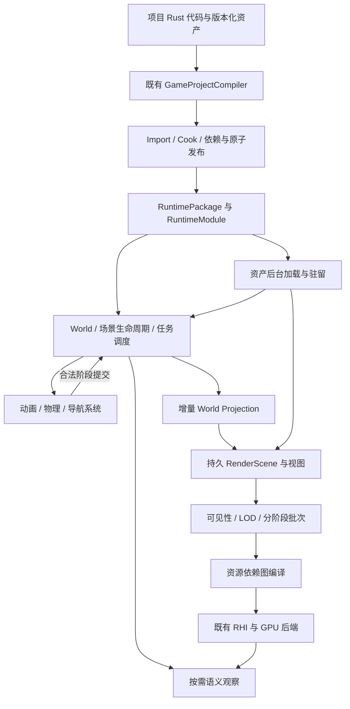

# 371 大型游戏级 AI 原生 3D 平台：方案 B v1 总方案

2026-10-30终态：**371 Windows功能施工完成并归档，完整资格独立待验**（`windows_functional_construction_completed_with_deferred_qualifications`）。本轮修复native阴影参数在混合计划readiness→draw重复上传、导致准备成功后实际绘制容量拒绝的确定性缺陷；176byte原额度反例先红，修复后10项阴影直接消费者及scoped Clippy通过。正常457交付身份已核对，原480tick短场景6/6断言、1张非零捕获、自然exit0，实际159.265秒。原完整K2未重跑：455历史22618tick失败/2图/9终断言未产生保持，没有原失败帧packet/字节快照，故不宣称该历史点已逐帧重放、重复上传是其唯一根因或完整路线通过。本轮确定性机制已修复，历史问题保留为完整路线回归待验。深层内存、OS显示、正式性能/压力/额外生命周期、满载故障配方和精确75%可选视觉降级继续未验证；其中视觉降级缺完整实现/消费证据，是交付限制，安全拒绝不等于降级实现。Android延期。A功能施工关闭并释放，不自动消耗余下授权；B/374、C安装、冻结游戏V0.0.5及Git索引保持。 证据`.artifacts/371/functional-finish-20261030-003316`；详见[完成记录](阶段完成记录/2026-10-30-371-Windows-Functional-Finish/00-Windows功能施工完成.md)、[待验/限制](阶段完成记录/2026-10-30-371-Windows-Functional-Finish/01-独立资格待验与交付限制.md)。

以下较早阶段摘要保留原时点；当前功能关闭范围以上述终态为准，未验证资格不改判。

2026-10-26：**S1、S2施工完成，遗留项已移交**（`construction_completed_with_deferred_items`）。S2普通组合Release已交付，240tick/30状态断言/5截图及26项独立像素检查通过；55文件副本核对与60帧启动通过。见[S2完成记录](阶段完成记录/2026-10-26-371-S2-Combined-Delivery/00-S2组合交付与施工完成.md)、[独立演示](../../../../03-Releases/deliveries/371-s2-combined-20261026/README.md)。完整lit压力、全内存、OS显示、Android及对应正式性能资格仍见[371-G](371-G-S1功能准入与延期资格审核.md)，不改判未执行/未通过结果。371仍含S3–S5，本轮已收尾，S3未开工；游戏固定V0.0.5。当前状态/执行槽以49/54为准，下方旧记录保留历史身份。

2026-10-20当前开发按已批准[常驻绘制与并行执行整改方案](371-S2-常驻绘制与并行执行整改方案.md)及总施工§0.26执行；其§3覆盖旧内部执行限制，安全不变量与原预算保持。已有部分源码/直接consumer，完整3D与S2尚未完成，具体状态只读49/54及[19记录](阶段完成记录/2026-10-18-371-S2-Execution-Chain-Continuation/19-常驻绘制与有界准备.md)。下文2026-10-09的design_documented为原设计时点，不是当前施工状态。

## 0. 决策与文档状态

- 日期：2026-10-09。用户已选择 **方案 B：自主架构 + 成熟领域库**，要求先把完整设计文档做好。
- 当前状态：`design_documented`。本文描述将要建设的完整 3D 平台，不宣称已有实现、规模资格或安装可用。当前工作仅包括文档与自审。
- 规范性上游：[371 总合同](371-大型游戏级AI原生3D平台-方案B-v1总合同.md)及其中引用的顶层 v1.1 权威。当前实现/安装见 [49](49-当前状态与下一步入口.md)，唯一施工入口见 [54](54-当前可自动化施工总入口.md)。
- 配套：[A 规模基准与资格矩阵](371-A-规模基准与资格矩阵.md)、[B 基础贯通设计](371-B-基础贯通设计.md)、[C 成熟引擎源码依据](371-C-成熟引擎源码依据.md)、[D 方案自审与决策记录](371-D-方案自审与决策记录.md)。

方案版本与实现版本分开。这里的资产/API 名称用于明确职责；新增 schema、ABI、工具查询字段只有经过实际 consumer 接入才变为可用接口。

## 1. 目标：复杂游戏的完整基础设施

本项目覆盖 3D 游戏制作所需的空间、资源、渲染、角色、模拟、世界加载与验证链路。目标是让项目从少量对象扩展到复杂角色、大量实例和持续加载的世界时，无需改写项目真相、重建资源体系或绕过 SDK 操作 backend。

### 1.1 用户要求到设计的映射

| 需求 | 设计响应 | 完成证据 |
| --- | --- | --- |
| 从一开始打好大型游戏基础 | 身份/坐标/生命周期/预算/线程先冻结，S1 真实批处理和异步分区贯通 | C3D-03–11、A 的变化比例/驻留/规模矩阵 |
| 能支撑复杂 3D 游戏 | 渲染、动画、物理、导航、世界、环境表现协作 | S2–S4 领域及综合消费 |
| 严谨 | 明确状态机、写入权、版本、负例、失败原子性和精度 | B 的故障矩阵与合同映射 |
| 可扩展 | 深 Module、typed 数据、资源依赖、后端接缝与真实第二 consumer | 材质/渲染 feature 扩展、领域后端适配 |
| AI 友好 | 普通 Rust/文本资产、命名语义、来源映射、按需观察和可回滚构建 | A 的 AI 创建/修改/修复任务 |
| 作为一个大项目推进 | 一个总合同、六阶段、统一依赖与资格 | 本文 S0–S5，避免以碎片接口逐个宣布完整 3D |
| 先文档 | 总合同先行、方案/基准/基础设计/源码依据/自审成组 | 本次文档检查；不启动实现或基准 |

### 1.2 路线选择

| 路线 | 收益 | 代价与结论 |
| --- | --- | --- |
| A：所有核心算法自研 | 源码与算法控制完全一致 | 同时承担物理、导航、压缩、渲染验证的长期成本；本轮未选 |
| **B：自主架构 + 成熟领域库** | 控制项目/SDK/Runtime/资产与生命周期，复用成熟领域算法 | 需要明确适配、版本、构建与验证；**已选** |

B 的自研核心包括项目合同、Compiler、Runtime/World、调度、Projection、资源管理、Renderer/RHI 组织、SDK、AI 工具与证据。领域库可承担物理求解、导航生成/查询、网格优化、纹理处理、动画压缩等。

整体嵌入 UE/Godot 或将 Bevy 完整 World/Asset/RenderApp 变成第二运行世界，不符合本轮继承原则。借鉴成熟引擎的数据与职责组织，不引入其整套项目真相和编辑器前置。

## 2. 当前基础、真实缺口与研究结论

### 2.1 基线复核

当前 358/359 已完成静态 3D 纵向链路，后续安装进入现行 367；具体当前安装事实由 49 维护。已有能力包含 typed ECS columns、层级脏传播、Projection、几何/材质缓存、真实 glTF/GLB 子集、相机深度、SDK/observe、独立 Windows 交付。

| 现有入口 | 核查事实 | 本方案动作 |
| --- | --- | --- |
| `engine_runtime/src/world.rs`、`archetype.rs`、`spatial_3d.rs` | 已有 typed columns、generation、dirty hierarchy；不是缺少 ECS | 在现有 owner 扩展批量提交/空间锚点/调度，按测量优化 hot path |
| `render_geometry/production.rs` | PreparedGeometry 可共享，但生产帧仍遍历代理并构造绑定缓存字符串 | 常驻实例、预编译 binding key、变更集消费与有限 rebuild |
| `wgpu_backend/real/geometry.rs` | Mesh buffer/pipeline 有复用，每 draw 的 uniform/bind group/pass 仍独立创建 | 实例 buffer/arena、按 phase 批次和 pass 复用 |
| `render_graph.rs`、`rhi_command_plan.rs` | 有图/资源/引用校验，尚不是完整资源依赖编译器 | typed access、拓扑/寿命/暂存资源与 history 管理 |
| `runtime_asset_loader.rs` | `load_async` 仍走同步文件读取；名称不代表后台能力 | 真实 I/O/decode/upload 分段任务、取消/优先级/预算 |
| `render_thread_worker.rs` | 已有线程/队列/fence 结构，部分深度以 worker 完成映射 | 分清 CPU/RHI/GPU/present 完成，接生产帧的实际安全退休 |
| `model_import` 与 `spatial_contract.rs` | 静态模型、局部 f32 TRS；skin/animation/morph 等明确拒绝 | 保留旧 consumer，新增明确资产/坐标版本及否定组合 |
| 342/343/AUI | 已有音频/粒子/UI consumer | 扩展 3D 空间与深度，保护既有组合 |
| `game_project_compiler.rs`、`desktop_export.rs`、`editor_core/src/android_export.rs` | Headless Compiler当前check/build仅接受WindowsDev，WindowsRelease/Android均拒绝；旧Android exporter仍读live project_root | S0盘点目标和SourceView消费；S1接通PC Release与最小Android正式构建/导出，Editor只消费共同owner；S5再验完整交付 |

370 两组开发态短窗平均 CPU 约 104/115 ms、GPU 约 3.7 ms，样例约 234 个实体。该数据仅用于提出 CPU 生产路径问题；没有干净 Release、固定负载与 profiler 证据时，不把某段代码直接判定为唯一耗时首因。原始数据在 `.artifacts/370/diagnosis/summary.json`，不是 371 已通过基准。

### 2.2 成熟引擎的采纳结论

详细文件、函数、版本与官方资料见 C。采纳的系统性原则如下：

1. Godot：Scene/Resource、持久 instance、RenderingServer/Storage 分层；dirty、BVH、可见性与实例批处理协作。
2. Bevy：MainWorld 到 RenderWorld 的短提取、render phases/binning、GPU preprocessing 能力降级、CPU/GPU asset 分离与预算。
3. UE：Game/Render proxy 隔离、RDG 的依赖编译、世界分区加载/激活、Cook key 与任务化动画。
4. Unity：BRG 的稳定 ID/实例 buffer/裁剪任务；Entities Graphics 与实际渲染管线职责分离。
5. Rapier/Jolt：成熟物理系统以明确世界、body/query/job 接口接入；选型依靠相同负载，不把语言或品牌当性能证明。

不复制 Godot RID/Variant 公开面、UE UObject/Blueprint 体系或 Bevy 内部 Schedule 作为项目 API；不要求 AI 操作 bind group、render pass 或物理裸 ID。

## 3. 总体架构和所有权

### 3.1 深能力接口

以下描述能力语义，不冻结新 crate 或可直接调用的 API 拼写。

| 深能力 | 输入 | 输出 | 隐藏的内部复杂度 |
| --- | --- | --- | --- |
| 空间/世界 | Scene、Prefab、实体意图、分区需求 | 提交后的 World 与变更集合 | 层级、身份、索引、激活/迁移 |
| 资产与构建 | source lease、导入设置、target | typed cooked payload、包与诊断 | 解析、压缩、依赖、缓存、发布 |
| 资源驻留 | 资源版本、优先级、预算、需求 lease | 分域就绪句柄或可恢复失败 | IO/decode/upload、去重、淘汰、退休 |
| 动画 | skeleton/graph、参数、tick、控制策略 | pose、事件、根运动请求 | 采样、混合、压缩、LOD、skin buffer |
| 物理/角色 | collider/body/control 意图与步长 | 查询 snapshot、接触事件、空间结果 | broad/narrow phase、solver、CCD、backend |
| 导航 | nav 数据、tile 需求、路径请求 | 路径/状态、避让建议 | bake、tile、路径失效、后台查询 |
| 渲染 | 已提交投影、视图、资源句柄、质量档 | frame/submit/evidence identity | 裁剪、批次、图、GPU 同步 |
| 观察 | run/scope/domain/time window | 有界结构化事实及必要截图 | 来源映射、采样、关联与过滤 |

单个底层变化应能被这些边界隐藏。例如替换物理库不改变 Scene/Prefab 身份，修改渲染实例布局不改变 AI 的材质槽，替换纹理压缩策略不改变项目 AssetRef。

### 3.2 扩展约束

扩展注册复用现有 capability/SDK/资产机制；声明其 schema、依赖、读写阶段、资源需求、平台支持和观察面。项目级 Rust 扩展由正常编译进入 RuntimeModule，领域系统扩展由 Engine 构建接入，不引入任意运行时 DLL 自动扫描。

渲染 feature 只能通过图访问合同声明资源和 pass；物理/导航后端只实现领域接口；新资产通过既有 Import/Cook/Assembler 接入。扩展失败必须能定位并隔离，不能使其它已激活领域半提交。

S1/S2 至少用一个额外材质变体和一个额外依赖 pass 验证扩展，不以“预留接口”替代真实 consumer。

## 4. 空间、调度与数据更新设计

### 4.1 空间表示

沿用局部 Transform3D，新增高精度 WorldAnchor 的定位语义。对每个视图先计算高精度世界位置差，再转换相机相对 f32；锚点迁移保留实体身份及世界位置，并转换 current/previous 数据。空间精度、局部范围、误差与转换负例由 S0 冻结，参考 A。

父子层级继续由共同 owner 传播，聚合 dirty roots 并去掉重复子树工作。变换、bounds、材质/mesh 绑定、可见性、实例参数有各自版本，单点变换不能失效未变资源。空间索引用 dirty bounds 更新；每视图可见性由相机/view epoch 和相关空间变化决定。

骨骼 joint 不必成为普通 gameplay 实体；挂点通过稳定 joint binding 查询。海量装饰也不要求每棵草拥有完整项目回调，使用带稳定实例索引与来源的实例集合资产/组件。

### 4.2 批量提交

SDK 允许项目提交类型化意图批次，内部在一个合法阶段验证与合并；同字段最后写入/冲突规则显式，结构变化与销毁优先级不能由容器迭代顺序决定。无变化写入应被识别为 no-op。

批次成本按变更数量与影响子树计算；不得为每条意图复制整个 World 或重新构造所有绑定。需要跨对象原子性的变更事务单独声明，局部错误的全部回退/逐项拒绝策略在具体 API 合同中固定。

### 4.3 固定步与任务图

总合同时序是语义依赖，不要求所有工作单线程。动画采样、可见性、解码和 cook 等可以批量并行；边界处统一接受结果。任务携带运行 epoch、输入版本、tick 和 source mapping。主线程只接受仍匹配的完成结果。

模拟状态与表现插值状态分开；输入延迟、fixed catch-up、frame lag 和 GPU 队列上限共同受预算。至少保留可诊断的顺序执行模式，便于比较并行结果；跨平台确定性按后端保证和实测范围报告。

## 5. 资产、构建和运行资源

### 5.1 资产族与 Cook

| 资产族 | 首期输入与产物 | 关键校验 |
| --- | --- | --- |
| Mesh/Model | generated、glTF/GLB；顶点/索引/submesh/bounds/LOD | 坐标、normal/tangent/UV、索引范围、压缩预算 |
| Texture/Material | 纹理语义、mip、平台压缩、PBR/Unlit 实例 | 颜色空间、采样、alpha、法线约定、变体上限 |
| Skeleton/Skin/Clip | joint hierarchy、inverse bind、轨道、压缩片段 | 稳定 joint ID、权重归一、绑定姿态、轨道目标 |
| AnimationGraph/Retarget | 命名参数、状态/混合/事件、显式映射 | 类型/循环、缺失绑定、阶段与资源预算 |
| Collision | primitive、convex、static triangle/heightfield | 动/静支持范围、非均匀缩放、质量/惯量与退化几何 |
| Nav | agent profile、源几何、tile/off-mesh links | 尺度、可行走规则、边界、tile 内存与版本 |
| World/Terrain/Instances | cell 描述、依赖组、高度场、植被、HLOD | 引用闭包、边缘、范围、驻留/激活策略 |
| VFX/Audio | 既有资产的 3D view/空间配置 | 能力、深度/原点、listener/source 生命周期 |

网格优化、LOD 生成、碰撞 cook、nav bake、纹理 mip/压缩与动画处理作为独立派生任务接入同一 Build Graph。一个材质颜色改动不能重新导入全部模型或重建无关导航。

源资产与派生产物有尺寸、层级深度、数量和解码预算；导入失败返回具体字段/子资产。缓冲布局、offset/alignment/endianness 和版本在格式冻结时规定，Runtime 不猜测布局。

### 5.2 加载与驻留

Loader 的 `load_async` 实现需要真正离开调用线程执行 I/O/解码，由有界队列提交进度。CPU 内容和 GPU 资源独立就绪；任务支持优先级、取消、请求去重与 generation 验证。

关键预算为 active CPU assets、GPU resident、I/O in-flight、decode scratch、staging upload、retiring resources 和 shader/pipeline caches。按 A 的固定策略测量。资源暂存时可跨帧分段上传，初次可用与最高质量可用可以分离，但必须声明最低必要质量。

没有消费者且在途使用已结束的版本可淘汰；高频进入/退出区域使用有界滞回避免抖动。资源缺失/超限不导致无限重试或后台错误日志风暴。

### 5.3 平台与发布

每个 target profile 固定 feature set、纹理/mesh 格式、shader variant、质量预算与后端能力。Windows/Android 使用相同项目语义和 SDK，产物允许不同。

PC Release与Android均需补齐Headless Compiler的目标消费；已有枚举不表示check/build可用。S1必须复用desktop_export及旧Android exporter的可用实现，接入既有Compiler/Build正式边界：消费同一SourceView/source lease与唯一Assembler，输出可验证包和真实目标产物。Editor adapter只调用共同owner；禁止扫live project_root绕过源码版本与产物身份。S0可保留现有dev诊断和Release技术探针，但不得冒充正式Release产品基线。工具链/设备未就绪时保留已证明进展，S1对应Release性能/Android平台资格仍未完成。

当前Android只有AndroidDev目标枚举，没有正式Android Release consumer。S0冻结优化目标/profile命名与版本，S1新增并贯通check/build/glue/目标Module与engine编译/包/verify；AndroidDev可用于开发反馈，不能给A的Release子档授予性能资格。

资产压缩库、物理/导航库等依赖按精确版本与 feature 编译，记录许可证/分发要求和目标工具链；这是选型证据的一部分。发布包封存真实消费的来源/派生身份与兼容要求，独立目录缺少原项目也必须可运行。

## 6. 渲染器方案

2026-10-10二维先行衔接：[372二维局部GPU几何与增量呈现方案B](372-二维局部GPU几何与增量呈现-方案B-v1方案.md)已确认并生成设计，尚未实施。371按用户请求暂停在S1-C前，372沿原共同渲染资源／packet／backend owner补齐首期二维必要增量，不依赖未实施S1-C才能开始，也不另建registry／退休器。371恢复时须读取372实际合同、复核S1-C/D受影响项并复用已验证共同部分；二维资格不自动授予3D实例／多视图／规模资格，UI composition与世界语义、内部布局保持分离。实际暂停／恢复状态仍只见49/54。

### 6.1 持久 RenderScene 与 GPU 数据

保留既有 RenderSceneState/Proxy，扩展紧凑的 geometry/material/instance/view 存储。实例持有准备好的资源索引，删除用 generation/tombstone 更新；空洞回收与压缩不能使在途索引指向新实例。

GPU 数据分三类：长期 mesh/texture/material、按变化上传的 instance 数据、每帧 view/skin/临时数据。上传使用有界 arena/ring 与脏区间；mesh/材质替换只更新受影响批次。连续 dirty ranges 可合并，稀疏更新与全量重传的切换阈值通过测量冻结。

持久buffer还需维护packet消费的区间内容版本，不能只保留资源lease。frame slot/COW或submission有序上传须保证慢worker仍读到旧snapshot的数据；连续transform/material/alpha更新与多个在途帧要有真实GPU对照。内容版本策略、峰值和退休共同进入S1验收。

基础 CPU 可见性和正确绘制作为必备路径。GPU culling/indirect 是相同语义下的高能力实现，设备不足时显式降级；不可把需要特殊 GPU feature 的唯一实现当成跨平台支持。

### 6.2 视图、裁剪与批次

每个 view 保存独立相机、层、viewport、深度/history、可见集合和排序。支持主相机、离屏/小地图视图及阴影视图，生命周期不依赖“第一个找到的 camera”。共享世界资源，各视图的可见性与原点分别计算。

初期使用 CPU 空间索引与 frustum/distance/LOD，后续加入可验证遮挡和 GPU indirect。opaque/mask 按兼容键分桶，透明按声明规则排序；shadow 的可见性不能直接等同主相机可见集合。

实例化按空间簇与渲染兼容性组织。不同实例参数进入实例数据，不通过复制材质资产制造对象差异。draw/pass/bind-group 新建数和 upload bytes 都要在 A 中有指标。

### 6.3 图编译与资源

将现有顺序 passes 升级为访问声明与可编译计划：依赖分析、输出可达性、错误校验、合法拓扑、资源寿命、临时纹理复用和 backend 执行。

开始可只执行单 GPU queue；图仍区分 external/persistent/transient/history。跨帧 history 有尺寸、相机切换、origin epoch、资源版本和 device epoch 失效规则。UI composition 沿用独立阶段，3D world depth 不侵入 AUI。

### 6.4 光照、材质和表现

首选 Clustered Forward+；S0 与简单 forward/必要的 deferred 参考做受控成本比较，冻结一个首期主路径。共享 material/cook 合同支持后续不同 renderer feature，不同时维护两套完整首期管线。

S0按A§3.1使用有限技术探针、同设备可复现实测参考和能力/带宽分析，不提前完成S2的完整生产consumer。比较范围、投入上限、输入和退出结论先记录；缺证据保持选型未关闭。S2以真实项目和完整BM-04重验，探针结果不替代产品资格。

首期表现包必须包含：

- metallic-roughness StandardLit 与 Unlit；base color/normal/metallic-roughness/AO/emissive，opaque/mask/blend，真实纹理采样和 mip。
- 方向、点、聚光；每视图 cluster/light list 与溢出策略；单位/强度约定明确。
- 方向光级联与有限预算的局部光阴影 atlas，bias/normal bias、质量档和稳定性观察。
- IBL 环境、sky、距离雾、HDR 工作流、tone mapping、曝光与至少一种正式抗锯齿方案。
- 深度正确的 3D 粒子、基础 decal/透明材质消费；后者的首期几何与混合限制显式。

S0 冻结基础 ViewDepthPolicy、首期默认及旧 U2 映射，S1 依此完成多视图/深度消费；S2 冻结 AA 首实现与阴影参数。需要运动矢量的算法必须实际消费 previous transform/skin/history，不能凭“有前一帧矩阵”宣称可用。Shader 变体有上限与预热，缓存与管线退休有预算。高级 GI/体积云/SSR 等只在独立能力包中扩大范围。

## 7. 角色与动画方案

完整链路为：Model Import → Skeleton/Skin/Clip Cook → Graph/参数 → pose sampling/blending → 根运动/事件 → 角色/物理接受 → 最终姿态/必要 IK → skin extraction → GPU 蒙皮。

首期 S3 必须完成：

1. glTF skin/animation 的明确支持子集，多 clip、非均匀时间键、有效插值及绑定校验。
2. 参数驱动状态/过渡、普通混合、additive 与骨骼 mask；事件跨 loop/seek/pause 的次数和时序确定。
3. GPU skinning、当前/上一姿态、动态 bounds；离屏/远距更新频率和动画 LOD。
4. root motion 输出与控制器实际位移分离，碰撞后不能把未执行位移再次叠加。
5. 基础两段骨骼 IK 与显式 joint 映射/姿态修正的重定向；不声称任意骨架自动 retarget。
6. 有界线性 morph target 混合，权重与 skin 组合顺序固定；完整表情/肌肉系统属于后续。

AnimationGraph 为可序列化资产，运行图编译为紧凑节点与参数表；命名参数便于 AI 编写，内部不每帧解析字符串 NodePath。骨骼身份在重导入后可追踪，映射歧义必须让 check 失败。

动画、物理与 gameplay 的写入模式按总合同执行。ragdoll 首期只要求关节/姿态接管接缝和有界基础链测试，不宣称完整高级主动布娃娃系统。

## 8. 物理、角色和导航方案

### 8.1 Physics3D backend 选型

候选 Rapier/Jolt。S0 定义同一验收输入并完成首期后端/版本选择和真实空间适配探针；S3 完成产品链与完整规模资格。基础贯通前即验证精度、跨锚点碰撞/查询、导航 tile 接缝与卸载失效，后端私有结构不进入包的公共语义。

对照包括 static/dynamic/kinematic、堆叠/休眠、CCD、查询排序、trigger/contact、关节、角色坡阶/移动平台、流式批量添加删除、后台查询、精度、回放、线程/内存和 Windows/Android 构建。记录拒绝支持的形状/缩放组合。首期只维护一个正式 backend，另一个仅选型比较。

物理资产 Cook 版本与库版本关联；换库触发受影响 cooked collision 失效，但普通项目 collider 语义与 AssetRef 保持。库升级必须验证边界行为，不能仅依赖 FFI 编译通过。

### 8.2 CharacterMotor

提供通用角色运动底座：地面检测、坡度/台阶、滑动、移动平台、跳跃/重力输入、碰撞层与查询。跑酷换道、技能、玩家/敌人分类留项目代码。root motion 和输入移动作为两类目标，有显式选择/混合策略。

控制器输出 accepted displacement、grounded、命中及限制原因；AI 能区分动画移动请求与实际位置变化。跨 cell 前预取必要 collision/nav，未知区域不得被当成空地。

### 8.3 Navigation3D

优先评估 Recast/Detour 的离线 bake + tile/query 模式，S0 冻结后端选择、版本与目标构建边界，并完成最小真实库探针；S3 再接完整产品与容量。AgentProfile 规定 radius/height/slope/step，nav mesh 不能对所有角色共享未经验证的单一参数。

路径请求异步且可取消，携带起终点、agent、nav revision、所经 tile 与请求 generation；tile 移除/动态障碍改变使受影响路径失效。项目可决定等待、局部路径或失败处理，SDK 不隐式 teleport。

局部避让与路径规划分离，不能把每个移动实体都强制写入全局 nav bake。基础动态障碍更新只在已加载区域发生，并受任务与重建预算限制。

## 9. 大世界、环境与持久状态

### 9.1 分区

WorldCell 保存稳定 ID、bounds、依赖、激活策略、远景/HLOD 与来源。streaming sources 可以来自玩家、相机或项目明确请求；渲染相机不是唯一世界加载权威。

后台基于 snapshot 计算需求与优先级，主世界在边界接受仍有效计划。Load 与 Activate 分离；取消旧需求不会卸载仍被其它 source/强依赖使用的 cell。邻域预取、滞回、慢加载和预算耗尽有确定结果。

跨区实体迁移、持续引用与项目存档状态由 World 生命周期协调。持久实体引用使用世界与placement/spawn实例身份，重复Prefab的原型来源ID不能代替具体实例身份。碰撞/nav/渲染的 cell 划分可不同，但激活策略必须证明 gameplay 所需邻域完整。预备碰撞/nav内容不得参与活跃求解或生产查询，commit epoch 在模拟安全点启用。

### 9.2 LOD/HLOD、地形和植被

模型 LOD 与动画 LOD 独立；HLOD 是远景替代表现资产，切换不得重复显示/产生洞或影响 gameplay 实体身份。退场与资源替换的在途帧仍安全。

首期地形选择高度场瓦片路线，提供边缘一致性、LOD 接缝、材质分层的有界子集，并生成独立 collision/nav 派生数据。任意体素地形不在首期。

植被使用实例集合与空间簇；风/外观等参数通过受支持材质/实例数据表达，碰撞与交互实例可单独提升为 gameplay 实体。不能把所有草木变成带独立脚本回调的实体才能渲染。

### 9.3 VFX、音频与存取

现有 GPU 粒子迁移到明确的 3D view/depth/原点合同；world/local simulation space、重定位、暂停、消亡和实例容量可观察。空间音频提供 listener/source、距离衰减、方向与混音生命周期；复杂声学传播后续扩展。

现有Player真实音频输出仅覆盖Windows real-window，其它平台目前进入HeadlessAudioOutput。S3在既有AudioOutput边界新增Android平台输出adapter，与空间混音一起验真机输出、方向/衰减、暂停/恢复及退出清理；只有DSP数值或headless计数不能关闭Android音频资格。

首期存取支持项目声明的持久实体/字段和分区状态，并保存版本/来源映射。snapshot 为逻辑序列化产物，底层池、GPU cache、路径工作 buffer 不写入通用存档。完整网络复制/rollback 是后续系统，需独立确定同步和确定性要求。

## 10. AI 原生工作流与知识

### 10.1 创作界面

AI 可直接编辑 Scene/Prefab、材质、动画图、世界分区和项目 Rust 逻辑。生成模板必须包含真实版本和可执行示例；命名材质槽、joint、参数和 layer 有补全/检查依据。高级用户保留受验证的 Rust/WGSL 扩展入口。

SDK 示例的目标语义如“给角色提交移动目标”“播放命名动画状态”“查询路径”“请求分区”“改变材质参数”；不要求 AI 操作骨骼 GPU offset 或后端物理句柄。具体拼写随实际 SDK 合同发布，本方案不伪造当前可用调用。

### 10.2 九工具扩展

| 既有工具 | 3D 增量内容 |
| --- | --- |
| inspect/check | 平台/能力/依赖、模型绑定、预算、未实现/不支持诊断 |
| mutate/rollback | 重导入映射、跨资产改名/替换、分区依赖与事务回退 |
| run/playtest | 真实同包运行、固定输入、角色/物理/分区场景，公开非确定性范围 |
| observe | 空间/可见性/资源/动画/物理/nav/任务状态和指定画面 |
| build/delivery_verify | 平台 Cook、能力封存、独立包及同消费身份验证 |

资料通过既有 AI Development Pack 交付：支持矩阵、最小例子、常见失败修复、版本迁移、规模预算解释。普通文件修改仍是一等工作方式，不强制每次小改编写 Feature Spec。

### 10.3 可解释失败

观察应回答“角色为什么没移动”“模型为什么不显示”“cell 为什么未激活”“这次构建为什么重做了 mesh”“GPU 内存为什么无法回收”。答案来自状态与依赖证据，不能由工具编造自然语言原因。

Off/Summary/Trace 分档覆盖新增领域。平时保留廉价计数与必要首因，逐对象详情按查询/trace 窗口产生。证据与 source/revision/package/run/tick/frame/view 关联；旧 run 读取不混用新世界。

## 11. 平台、预算与资格

负载与数值唯一入口是 A。PC 主档候选 1920×1080/60 FPS，Android 为独立规模与质量子档。需要固定硬件、驱动/API、build profile、present mode、资源复杂度和温控条件后才能形成正式性能门槛。

先分别测实例/变化比例、材质光照、角色、物理、nav、流式、生命周期，再测综合场景。万级实例、百级角色、千级物理是不同维度的设计目标，不隐含任意复杂内容同时达标。

CPU 提交、GPU timestamp 与实际呈现间隔分别测量；P95 不相加，CPU 时间不倒数冒充显示 FPS。稳态与冷加载尖峰、可选质量降低与必要资源 admission failure 分开报告。

每个声明绑定资产配方、输入脚本、版本与二进制身份。headless 提供逻辑/合同证据，真实窗口/设备提供画面与平台证据。不能用同一个“passed”概括所有资格。

### 11.1 验收依赖与反馈链修订（2026-10-14）

用户确认[371-F](371-F-验收依赖与性能反馈链.md)。按测量维度保留证据，解除最终OS关联对全部规模工作的阻断；原预算和完整阶段退出保持；开发准入另按2026-10-15的371-G，不把完整资格当一切下游开发前置。构建与测试分层、有效环境身份和明确步骤预算落实于既有owner，不增加新runtime权威。

## 12. 分阶段项目路线

| 阶段 | 输入与主要工作 | 退出条件 | 未完成时的表述 |
| --- | --- | --- | --- |
| S0 总合同与选型冻结 | 本文档组；源/包/平台盘点，硬件/负载 manifest，架构接缝与测量口径，首渲染路径 | S1 前置技术项关闭；基准生成/测量方案可执行；现状证据可复现 | 设计/测量准备完成，不称底座完成 |
| S1 规模基础贯通 | B 的持久实例、批量提交、真实资源图/后台加载、最小分区、退休与兼容 | 变化比例、真实多视图、两个 cell、取消/迟到/在途释放、平台最小贯通通过 | 基础能力按已消费范围报告，physics/nav 未接不能算跨区模拟 |
| S2 完整渲染表现 | PBR/灯光/阴影/环境/AA、多视图、材质变体与3D深度组合 | 真实资产、图访问负例、画面与 GPU/CPU 成本，质量降级 | 仅对应表现档资格 |
| S3 角色与模拟 | Skeleton/Clip/Graph/skin/IK/retarget/morph、物理/控制器/nav、空间音频 | 同包角色行动/接触/路径/根运动协作；重验真实跨 cell 领域 | 各领域 source/integration，不能冒称完整大世界 |
| S4 大场景与环境 | 完整 streaming、LOD/HLOD、terrain/vegetation、GPU规模路径、存取 | 长距离/传送/重复加载、边界碰撞/路径失效、内存与峰值受控 | 指定世界与规模档通过 |
| S5 普通项目与发布资格 | 复杂角色战斗场景、大场景探索、多视图/策略消费；AI完整任务、旧项目与平台交付 | A 资格矩阵、独立包、来源/安装区分、失败记录与范围全部闭合 | 未达项保持未完成，不能自动删除指标 |

开发依赖为 S0冻结 → S1对应consumer的功能准入 → S2/S3 → S4 → S5，完整阶段资格另行收齐。2026-10-15用户授权按[371-G功能准入与延期登记](371-G-S1功能准入与延期资格审核.md)先推进Windows S2-A，不以S1全内存/正式三轮/OS显示资格阻断材质开发；不能据此宣布S1完成或自动准入全部S3领域。S2/S3是逻辑可分离领域，不改变唯一施工槽规则。每阶段通过后把实际字段/consumer/证据补回对应合同；不为每个小函数额外建立平行正式系统。

S1 与 S4 都包含 streaming，但职责不同：S1 验证真实生命周期与交接正确，S4 扩大规模并连通完整模拟。详见 B。

## 13. 兼容、迁移与回滚

1. 保留 358/359 旧格式 reader 和静态 Unlit 正确性；新资产/能力显式选择新格式。旧 reader 必须拒绝不能消费的必要字段/能力。
2. 先在既有 owner 内接入新数据路径和可测计数，再让新 3D profile 使用；通过同场景差分验证后收敛旧低效执行实现，不形成永久双写真相。
3. typed SDK/ABI、包/schema、观察协议分别评估版本。新增字段被忽略的组合列为负例，不能只提高一个 engineVersion。
4. 旧 2D/AUI/粒子和静态 3D 在同一新引擎候选上复验受影响组合；复用身份未变的独立证据，不机械跑全部历史 suite。
5. 源项目迁移有 dry-run/影响映射和 rollback；构建发布原子性与安装替换是不同事务。文档/源码完成不自动更新用户 Provider。

## 14. 风险与决策责任

| 风险 | 处理方式 | 决策/验证阶段 |
| --- | --- | --- |
| 范围过大，只有接口没有 consumer | 每阶段完整纵向链路 + A 负载，不把占位作为资格 | 全阶段 |
| 本地 dev 测量误导设计 | 同内容 Release/profile、分段 profiler 和固定机器；保留原失败 | S0/S1 |
| 线程/缓存增加维护成本 | 一个 owner、有限队列、明确失效与销毁，stress shutdown/cancel | S1 |
| 材质/渲染路径选错 | 共用资产语义，受控光照/透明/带宽测试冻结首路径 | S0/S2 |
| 大坐标与后端能力冲突 | 有界精度与局部空间转换，远距碰撞/nav/历史数据验证 | S0/S3 |
| 移动端后补导致重构 | S1 真实最小设备贯通，平台子档/资源格式早期检查 | S1，最终 S5 |
| 库版本/FFI/分发负担 | 固定版本/feature，依赖矩阵与同负载验证，首期一个正式实现 | S0/S3 |
| AI 开发接口过低层 | 可执行高层例子、错误恢复任务与实际修改成本 | S1/S5 |
| 文档预算成为未经证明的承诺 | 设计目标、冻结配置和已测资格分开，A 唯一维护数值 | S0–S5 |

待冻结项详见 D。技术选型在已选 B 范围内按证据决定；若需要改变用户目标、上位权威、首期范围或降低已冻结验收规模，必须先修订设计并说明取舍。

## 15. 本轮文档交付与后续入口

本轮完成总合同、总方案、规模基准、基础贯通、源码依据和自审，以及入口导航同步。文档检查覆盖本地链接、条款/阶段映射、状态边界和技术决策责任，不以代码测试代替设计审查。

用户随后要求方案复审、生成施工文档并再审核，已形成覆盖S0～S5的[总施工文档](施工文档/已完成/371-大型游戏级AI原生3D平台-方案B-总施工文档.md)，问题修订与审核见[371-E](371-E-方案复审与施工文档审核.md)。未来实施从其S0实际前置冻结开始，按届时源码/依赖/设备复核后激活；目前只完成文档，当前槽与待执行状态由54决定。
