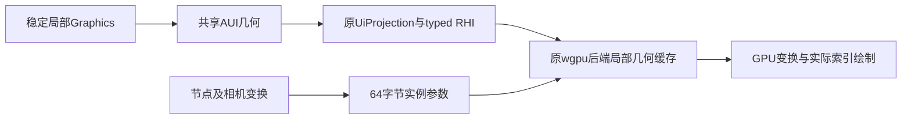

# 372：二维局部GPU几何与增量呈现——实际合同与验收

2026-10-11 局部缺陷修复：原 372 游戏向右滚动超过一屏后，非裁剪 world 容器自身离屏，C2 错误将其边界剔除状态传播给仍在屏内的子节点，导致整场消失。独立区分继承可见性与自身边界剔除，同时保持空裁剪链；46 项相关 owner/consumer 测试、正式 Release 导出/加载验证及原 559 帧 GPU/CPU 画面复测通过。新包为 `G:/gameEngin-deliveries/pixel-jump-camera-fixed-20261011/release/Game.exe`，详见[修复记录](../../samples/pixel_jump_adventure_project/Evidence/2026-10-11-世界节点消失修复.md)。此为用户报告的既有实现回归修复，不重开 372 主线；371 唯一槽、默认安装/config 保持。下面的 2026-10-10 数据属于原冻结二进制，不能作为新包全量性能资格。

2026-10-10。状态：`windows_sample_source_delivery_passed`。用户已确认方案B并授权生成施工后直接施工；P0–P3完成。范围是稳定Graphics2D经原AUI／UiProjection／RHI进入GPU，以及像素项目适配、Windows dev／Release独立交付；安装Provider仍为49所列contain基线，371保持暂停于S1-C。

## 1. 原因与实际修复

原项目把camera减进地形图元和内容描述，滚动使Paint／剖分／上传反复发生；旧消费端即便命中局部剖分cache，仍在CPU逐顶点生成最终屏幕坐标。吃蘑菇改变角色形态，但真正持续拖慢的是滚动引发的整场几何工作。节点不变时复用局部几何；相机和节点移动更新参数；GPU每帧仍绘制可见内容。

`AuiMeshPayload`保留不可变Arc源，只有Graphics准备能赋予local资格；raw Custom和旧JSON反序列化保持原CPU路径，旧flat mesh JSON形状不变。局部顶点／索引与实例仿射、线性Tint、view映射、target scissor分离，原typed图和后端消费。暖快通路不hash／序列化／深拷贝大mesh，也不遍历顶点做CPU投影；冷几何验证一次。

## 2. 快通路与生命周期边界

首期为无纹理可信Graphics；最终target边界精确为整数的轴矩形祖先clip进入scissor。非整数、旋转、圆角等复杂clip逐项原CPU精确回退；text／image／raw mesh保持原序，不能跨fallback合批。surface contain viewport继续映射scissor并恢复后续普通draw状态；镜像、pivot、Tint、透明顺序、8层clip、零scale和DPI按实际GPU测试证明。

局部GPU缓存1024项／32MiB、retiring32MiB；单包活动几何同限。实例4096项×64B＝256KiB单页，CPU保存不可变packet，每次消费即时write→encode→submit；同queue有序上传保护各次提交。资源退休按真实`queue.on_submitted_work_done`及device poll，预算压力可等待，容量超限明确拒绝并可恢复。新内容单调incarnation＋Arc强身份；旧包可从不可变CPU内容重建，设备重建不复用旧handle。CPU Graphics64项／8MiB预算包含原源与typed局部副本。

旧→新→旧packet的变换／Tint／内容替换及1025次几何替换都有真实像素证据；另有A→B→A三个不同target连续提交、中途不等GPU、随后读回各自像素的测试。后端draw／instance计数在实际`draw_indexed`处递增，不用准备量冒充实际draw。

## 3. 项目关系与冻结负载

固定背景、HUD及viewport Rect clip；其下公共world平移，13个地形chunk、goal、8平台／48金币／32actor／1玩家槽。chunk16列（256游戏单位／512canvas单位），局部内容key排除camera；对象移动只改placement，形态／步行动作切换局部内容。地形内部改变只更新所在chunk；边界一列AA重叠使边界改变更新两个相关chunk，各chunk按自身条带clip，不重复画重叠区。可见性限制提交。

首轮截图的world默认Panel边框和分块AA接缝已修复，首轮证据保留。最终dev对原big-still排除HUD48行后有148个边缘像素差异（最大23），来自项目分块／对象独立后的AA组合；x767长竖线和x831地形接缝差异为0。同项目CPU／GPU静止及滚动的两profile像素比较均通过最大差≤2，见terminal-results；因此不能将旧项目AA变化归为GPU着色错误。

Windows x86_64，RTX3070／NVIDIA591.86／Vulkan，960×540窗口、Fifo，原输入big-still／big-scroll／small-scroll-safe。固定360帧、预热210、采样150；CPU参考只在对应子进程设`AIFE_AUI_CPU_GRAPHICS_REFERENCE=1`，同profile同DLL／Module／输入，其余正常GPU。Release前冻结总CPU P95≤16.67ms、AUI P95≤2ms、实际retained draw≤64／帧，三场景全部通过。dev单独报告。目标约60Hz由真实FPS截图辅助判断，不用CPU耗时倒数替代，不宣称所有帧均达60FPS。

## 4. 实测

| profile／路径 | 场景 | CPU P95 ms | AUI P95 ms | 截图显示 FPS |
|---|---|---:|---:|---:|
| 历史dev／旧CPU | big-still | 11.4699 | 4.7931 | — |
| 历史dev／旧CPU | big-scroll | 45.1509 | 23.3720 | 25.1 |
| 历史dev／旧CPU | small-scroll-safe | 52.6820 | 26.6600 | 23.4 |
| dev／gpu | big-still | 9.9237 | 2.5288 | 58.8 |
| dev／gpu | big-scroll | 12.2546 | 5.0899 | 58.7 |
| dev／gpu | small-scroll-safe | 12.2272 | 4.9297 | — |
| dev／cpu | big-still | 12.0965 | 2.7742 | — |
| dev／cpu | big-scroll | 27.2153 | 5.7255 | 44.4 |
| release／gpu | big-still | 2.3646 | 0.8989 | — |
| release／gpu | big-scroll | 2.8841 | 1.4655 | 59.0 |
| release／gpu | small-scroll-safe | 3.1441 | 1.4197 | 59.0 |
| release／cpu | big-still | 2.5701 | 0.9104 | — |
| release／cpu | big-scroll | 4.9355 | 1.4859 | — |

吃蘑菇后滚动：新项目dev CPU参考27.2153ms → GPU 12.2546ms，是同产物的路径收益；旧dev 45.1509ms → 新GPU则同时包含项目分块收益。Release结果独立列示，不能把编译优化算入GPU路径收益。

下表字节为150采样帧累计；draw是实际每帧最大值，不能将总量当每帧量。

| profile／GPU场景 | 几何 B | 参数 B | fallback B | 实际retained draw／帧最大 |
|---|---:|---:|---:|---:|
| dev／big-still | 0 | 83776 | 11136 | 12 |
| dev／big-scroll | 5264 | 84608 | 816288 | 12 |
| dev／small-scroll-safe | 5264 | 75008 | 847200 | 14 |
| release／big-still | 0 | 83776 | 9792 | 12 |
| release／big-scroll | 5264 | 84608 | 815904 | 12 |
| release／small-scroll-safe | 5264 | 75008 | 847584 | 14 |

静止暖局部几何上传0；滚动仅冷形态／新可见资源允许少量几何上传。原fallback上传仍有HUD／字形及精确回退，不宣称整个游戏CPU顶点生成0。机制测试直接断言暖合格图形仅平移时剖分／局部GPU几何上传／绘制消费CPU顶点生成为0，参数上传64B；项目camera不进入appearance key／图元的测试和既有属性失效规则支持Paint局部复用，不伪称该GPU单测直接计量了SDK Paint回调。游戏extensionCalls仍包含其他节点／冷内容调用。完整rawCpuFrames保留；最后截图读回／PNG会增加第360帧renderSubmit及max CPU，未删除该帧或用P95掩称全部帧流畅。

## 5. 需求与终验证据

证据根[.artifacts/372/20261010](../../.artifacts/372/20261010/)，汇总[terminal-results](../../.artifacts/372/20261010/terminal-results.json)，所有首失败及完整日志保留。

| 需求 | 实际证据／边界 |
|---|---|
| R01/R02 | p0-red：旧暖平移仍生成72 CPU顶点；p2-green-final-source的暖平移红绿＋JSON不授信owner测试；共享源和参数分离 |
| R03/R04 | 项目局部移动／内部砖块key测试、三关所有局部Graphics预算测试；真实滚动几何字节与cachehits，1025次缓存淘汰／旧包重建 |
| R05/R06/R07 | 5项Draw2D＋4项presentation真实GPU；raw透明mesh交错、holes／curve／半像素、线性Tint／alpha、复杂clip回退及DPI／镜像／pivot |
| R08 | 163项AUI owner已通过，身份未变行为证据复用；最终24项retained owner覆盖发布、回滚、动画、重挂载、删除generation／shutdown，数量有重叠不相加 |
| R09/R10 | 真实旧／新／旧变换、Tint和内容替换；三次不等待提交各target读回；真实completion、1025替换、损坏index／4097实例拒绝后恢复、GPU重建 |
| R11 | 27项项目测试；最终89项real-window Player通过／3项既有OS烟雾ignored；正式build／retained delivery verify、Dev冻结玩法playtest及Release真实窗口回放及两profile独立副本真实窗口 |
| R12 | 两profile同输入CPU／GPU、真实draw／实例／上传、FPS截图与冻结Release预算通过；非全后端draw规模／非3D／非其他硬件资格 |

最终GPU集成编译74s、运行2.01＋0.56s；最终Player编译128s、运行1.41s；项目编译13.34s、运行0.07s；24 retained owner运行0.46s。最终受影响rustfmt／Clippy通过，已有warning保留，未新增allow；未运行全workspace、Android、LocalCI或安装升级。`p2-terminal-final.log`曾按单测filter选择到0项集成，不作集成通过证据；最终无filter GPU日志才是终验。

## 6. 源码与交付身份

759项源码／Cargo／项目输入由source-qualified.json绑定（原含118份旧Evidence及1份.aife生成锁的清单另存，生成证据不属于源码）。HEAD保持已有工作树；有历史／用户修改，未reset／clean／commit，不授clean exact-commit发布seal。construction-source.diff隔离14份已备份／新增源码差异；项目tests.rs新增2项和预算适配、AUI及Release profile另按当前输入hash记录，不伪称整仓git diff均为本轮。

源码Provider SHA `98F63AD19682FB0EEF858549153A271ABDC052317BEBF726BCD4D5D85F541C1B`只承担正式Compiler入口，实际Engine SDK／Module源由producer重新消费；它不是当前聊天已安装宿主。普通交付Assembler／DLL／descriptor／manifest与retained delivery reader通过。

- dev：`G:\gameEngin-deliveries\372-pixel-jump-retained\dev-qualified`；38个文件完整副本校验及运行后校验通过。Game `9b07e318bebe6d5070b2137e776ea3f2082d7f54e154f5a753d26fbb81e7630f`；Engine DLL `da59d600fc48f30f39aff7b402bfd8faeec3db1f060b1d6d540c6e3f2c1b5a23`；Module DLL `ff22536aadf70a4c79de795e7a26a1e068274452e9a801d71eece9126e4fff24`；delivery `sha256:812b61d1c2fddaa42162d99857c5a74874214932240d63048163194d70e8da15`。
- release：`G:\gameEngin-deliveries\372-pixel-jump-retained\release`；38个文件完整副本校验及运行后校验通过。Game `1d083de56a5d5bd027be28409a600c77cf7f6cb347656b65d7c6b32b757c6f39`；Engine DLL `060d76ce7556dd485f9569a6a5a2b18ff5081be3bff7ae6a4a229360a276c004`；Module DLL `553c59581d8a4e2bbe0f9f4ab627afca0b44a9ac4d804463e6a9961ce33e9133`；delivery `sha256:c5e17ce6f4aaeed0200c762eeb6d0e099368bf3430a54eafba189cf542cf8193`。

Release第一次Module冷编译、第二次Engine冷编译均触发既有30s工具超时，非编译错误；首报告与owned进程组清理结果保留。在producer原缓存用精确profile／target／环境完成编译，再重新正式build／verify，不手写prepared receipt。Release Engine冷编译9m27s；其成本与实际测试执行分列。

正式Release build／verify成功后，额外调用玩法tool被既有“仅Windows Dev”边界拒绝；新Provider session也拒绝旧session的deliveryRef，两次拒绝均保留且未改工具边界。随后在同一新session正式构建dev并确认Game／Engine／Module与已测dev逐字hash相同，再对该retained delivery运行pixel.smoke，overall=passed。脚本最后打印大中文结果遇GBK编码异常，但已经落盘的正式tool结果及成功进程结论有效，修复打印为紧凑ASCII后不重复真实playtest。Release按三组原输入窗口回放验收，未伪称Release正式semantic tool已授资格。

## 7. 完成与限制

施工起点08:11 UTC，文档收尾09:57:16 UTC（北京时间17:57），本轮约106.3分钟，未超三小时；这表示引擎372优化、项目适配和验证用时，不等于原游戏从零制作时长。

source、Windows样本及本机冻结性能资格完成；默认安装／配置与旧游戏包核对未改，owned构建／回放进程为0，缓存和证据保留。371继续暂停，恢复时读取本合同；不授Android／3D／大型规模／所有GPU资格。项目README既有47.5px跳跃与48px管道矛盾、未取得正常三关通关证据仍保持，本轮渲染施工没有修改玩法参数或冒充三关游戏全验收。

最终收尾复核：10:01:35 UTC，包含归档后源码身份／链接核查的总用时约110.6分钟（1小时51分钟）；施工归档节点仍为上述106.3分钟。核查未修改产品源码或重新运行已通过的GPU／游戏测试。
