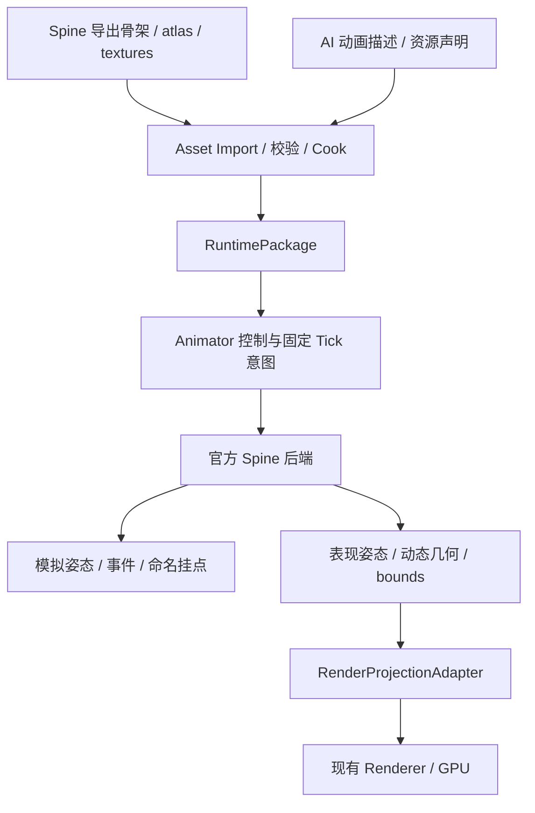

# 374 Animator 与 Spine 骨骼、网格变形及动作混合：方案 B v1

> 状态：用户于 2026-10-21 明确选择方案 B，并授权生成正式方案文档。
> 选定方案：统一 Animator 控制层 + 官方 Spine 求值后端 + 现有 RenderProjection。
> 本文是设计合同。Windows功能施工已按用户2026-10-29确认完成，完整性能资格独立待验；当前合同见[374-B](374-B-实际合同与验收.md)§27及[功能完成记录](阶段完成记录/2026-10-29-374-Spine-Animator-v1/00-功能施工完成与性能待验.md)。
> 审核：[374-A 方案审核与施工文档自审](374-A-方案审核与施工文档自审.md)；实施准备：[374 总施工文档](施工文档/已完成/374-Animator与Spine骨骼网格变形及动作混合-方案B-总施工文档.md)。施工文档激活后以 54 的有效路径为准。
> 上位权威：[产品需求 v1.1](00-AI-First-Game-Engine-权威产品需求-v1.1.md)、[架构设计 v1.1](00-AI-First-Game-Engine-权威架构设计-v1.1.md)。
> 实现/安装基线只见 [49](49-当前状态与下一步入口.md)，施工状态只见 [54](54-当前可自动化施工总入口.md)。

## 1. 系统用途与目标

本系统让普通项目使用 Spine 制作的二维角色，实际播放骨骼动画、加权网格及 deform，并完成动作切换、动作叠加、局部混合和事件消费。例如角色下半身持续跑步，上半身攻击，衣服随骨骼及网格关键帧变形，攻击结束后平滑恢复下层动作。

成熟工具对标是 Unity 的 Spine 动画/渲染组件与 Godot 的动画控制、混合、姿态应用分层。本引擎采用 No-Editor 主线：AI 编辑普通资源声明和动画描述，经 Compiler、RuntimePackage、Rust Runtime、RenderProjection 到真实 GPU；Native Editor 只是可选消费端。

AI 友好的目标不是让 AI 手写骨骼矩阵、deform 数组或 GPU 命令，而是让它能发现资源能力、声明语义动画、提交 typed 意图、定位字段错误、验证实际播放和呈现结果。

## 2. 当前基础与相邻方案

| 基础 | 已有事实 | 本方案增量 |
|---|---|---|
| [276 Animator2D](276-Animator2D-Mini-Clip-Controller-Fixed-Tick-Present-v1方案.md) | Sprite 帧 Clip/Controller、Fixed Tick、状态切换与呈现 | 新增 Spine 后端，不把骨骼编码成 Sprite 帧 |
| [341 AI 动画描述](341-AI友好Animator2D动画描述与显式播放-v1方案.md) | 单文件描述、命名 play、有限规则、项目 mutation 提交 | 继承作者体验，增加层、过渡、事件和后端能力校验 |
| [371 方案 §7](371-大型游戏级AI原生3D平台-方案B-v1方案.md) | 已设计通用动画图、混合、mask、事件、模拟/表现分离 | 共享控制词汇与接口接缝；Spine 自有求值，不宣称完成 371 S3 |
| 365 / 372 通用二维表现 | 已有二维呈现、局部几何和生命周期基础 | 评估复用其几何/资源设施，不预设已满足 Spine 的所有顶点和混合需求 |

本次核对源码入口：

- `rust/crates/engine_runtime_core/src/animator2d/schema.rs`：现有 `CookedSpriteAnimationClip2D`、`CookedAnimatorController2D`、`RuntimeAnimator2D`。
- `rust/crates/engine_runtime_core/src/animator2d/evaluator.rs`：既有命令、Fixed Tick、实例代际和 Off/Summary/Trace。
- `rust/crates/project_authoring_execution/src/animator_description.rs`：341 描述展开、名称与预算校验。
- `rust/crates/project_authoring_execution/src/neutral_assembler.rs`：项目装配接入参考；最终仍由现有 ProjectRuntimePackageAssembler 链进入运行包。

这些位置是设计定位，不是本次修改清单；不得在旧 `cooked-animator2d-registry.v1` 中静默改变字段含义。共享作者控制语义不要求先重写全部 Sprite Animator 或等待完整 3D AnimationGraph。

游戏开发仍固定消费 V0.0.5；本方案不修改冻结目录、Provider、安装、现有游戏或 371 施工状态。

## 3. 备选与已确认决策

| 方案 | 内容 | 结论 |
|---|---|---|
| A | 专用 Spine 播放组件直接暴露轨道 | 可作为内部探针；独立作者控制体系会增加 AI 负担 |
| B | 统一命名、参数、层与意图；各后端负责真实采样/混合；共享投影链 | 用户已选定 |
| C | 全量转译 Spine 到自研骨骼/约束/变形格式 | 首期不采用，语义兼容与维护成本过高 |

方案 B 的统一边界是控制合同、资源身份、事务、时钟、事件输出、诊断和验收。Spine 与未来 glTF 后端不强制共享同一姿态内存布局；不同后端能力不能通过空实现伪装一致。

## 4. 成熟引擎与官方源码依据

### 4.1 Unity Spine：动画与渲染分离

[4.3 官方组件说明](https://esotericsoftware.com/spine-unity-main-components-4.3)明确拆分动画与渲染组件；[4.2 SkeletonAnimation.cs](https://github.com/EsotericSoftware/spine-runtimes/blob/4.2/spine-unity/Assets/Spine/Runtime/spine-unity/Components/SkeletonAnimation.cs)可追溯 `UpdateAnimationStatus → state.Update`、`ApplyAnimation → state.Apply → UpdateWorldTransform`。

采用：时钟推进、动画应用、骨骼世界变换、渲染提取分开，支持世界呈现与未来 UI 消费端复用。不能照搬：MonoBehaviour 生命周期、GameObject 依赖、Inspector 成为必需输入。

官方同时提供 SkeletonAnimation 和 SkeletonMecanim，后者有额外混合与关键帧要求。本方案采用官方 Spine 求值，不先把全部 Spine 时间线转为旧 Animator2D Controller，也不把 Mecanim 适配当作 Spine 全功能兼容保证。

注意：4.2 源码与 4.3 组件文档用于比较职责，不表示两版本二进制或格式兼容。

### 4.2 Spine 官方 Runtime：保留混合及变形语义

可重复访问的研究分支为官方 `spine-runtimes/4.2`，不是生产最终版本锁定：

- [AnimationState.c](https://github.com/EsotericSoftware/spine-runtimes/blob/4.2/spine-c/spine-c/src/spine/AnimationState.c)：`spAnimationState_update` 推进时间，`spAnimationState_apply` 按轨道应用，`_spAnimationState_applyMixingFrom` 处理被中断的混合来源链。
- [VertexAttachment.c](https://github.com/EsotericSoftware/spine-runtimes/blob/4.2/spine-c/spine-c/src/spine/VertexAttachment.c)：`spVertexAttachment_computeWorldVertices` 分别处理加权/非加权顶点及 slot deform。
- [Animation.c](https://github.com/EsotericSoftware/spine-runtimes/blob/4.2/spine-c/spine-c/src/spine/Animation.c)：时间线应用包含离散与连续属性，不能将全部属性统一做线性插值。
- [官方 C++ 源码目录](https://github.com/EsotericSoftware/spine-runtimes/tree/4.2/spine-cpp/spine-cpp/src/spine)：生产接入优先使用同版本 spine-cpp；C 源码只作为已核对语义参考，不意味着运行时同时链接两套库。
- [Applying Animations](https://us.esotericsoftware.com/spine-applying-animations)：多轨叠加、排队、Crossfade 与 empty animation 的行为依据。

采用：官方对曲线、旋转、deform、附件和混合来源的处理。不能照搬：项目直接保存 TrackEntry 裸指针、回调内任意重入修改 World、把停止轨道等同于平滑恢复下层。

初稿依据C实现及Unity C#。Gate A已取得并逐blob核验官方spine-cpp提交`e7dc1435fa4a0083ab431f1b28e083c14a1f5c68`，编译实际C++库，核对Animation所有权/property IDs、AnimationState hold/apply、deform与事件路径；具体函数结论与资格边界见374-B §1–3。4.2不再是生产锁定的移动分支别名。

### 4.3 Godot：控制、混合与应用分层

本地参考源码 `I:/godotAllCode/godot`：

- `scene/animation/animation_mixer.cpp:1026`，`AnimationMixer::_process_animation` 组织混合；`_blend_calc_total_weight`、`_blend_process`、`_blend_apply` 分开权重、计算与应用。
- `scene/animation/animation_tree.cpp:171`，`AnimationNode::_blend_node` 使用过滤轨道索引缓存。
- 既有 [371 成熟引擎源码依据 §2.4](371-C-成熟引擎源码依据.md)记录动画资产、采样/混合、Pose、蒙皮的分层。
- [官方 AnimationTree 文档](https://docs.godotengine.org/en/stable/tutorials/animation/animation_tree.html)说明状态机、Blend、OneShot 与过滤用途。

采用：可序列化控制资产、准备期绑定、紧凑轨道索引、共享资产与实例状态分离。不能照搬：运行热路径任意字符串 NodePath/Variant 反射、场景节点回调作为唯一执行入口。

### 4.4 项目参考与外部审查适用性

已检索本项目源码参考与 `审查目录/其它AI审查目录`。其中“10-Authoring Walkthrough Spine 方案审查”谈的是 authoring workflow 主线，不是 Esoteric Software Spine 骨骼动画，不能作为本方案技术审查结论。当前未发现针对本方案的专门外部审查；本文件自审不冒称外部审核通过。

## 5. 架构与执行链



| Owner | 职责 | 不允许越界 |
|---|---|---|
| Import/Cook | 骨架、atlas、纹理闭包、能力清单、名称映射、预算 | 不依赖 Editor 内存；不由 AI 手写最终包 |
| Animator 控制 | 参数、命名状态、优先级、中断、层与命令排序 | 不另做一套 Spine 时间线混合后再让官方重复混合 |
| Spine backend | 时间线、混合、约束、骨骼、deform、实例状态 | 不直接操作 World、Renderer 或项目业务 |
| 模拟消费 | tick 对应事件与声明挂点快照 | 不从 GPU/插值后的表现姿态读取命中依据 |
| RenderProjection | 已求值几何、材质、绘制顺序、可见性 | 不解析作者规则、项目参数或 Spine 源路径 |
| Renderer | 缓冲、管线、上传、实际 GPU 呈现及退休 | 不读 Animator 作者描述 |

只新增既有 Projection 域内的 Adapter/Report，不新增 SpineBridge、独立同步器、工具大入口或架构路由层。

## 6. 官方后端、FFI 与版本合同

1. 首选官方 spine-cpp，通过窄 C 接口与 Rust 安全包装接入；第三方库与薄适配单独组织，不向项目 SDK 公开 C++ 类型。
2. 库、编译器、目标 ABI 和导出格式必须作为一组锁定到确切提交/版本，记录源码摘要及许可文件。研究分支 4.2 不代表最终选版；施工的首个技术合同必须明确实际支持版本和导出样本。
3. Rust 包装独占实例可变状态。共享 SkeletonData/Atlas 等只读数据；实例动画状态、骨骼、slot、deform、约束和事件队列不能相互共享。
4. 不跨边界泄漏裸指针、异常或 Rust unwind。C 接口返回有限错误码/compact result；异常策略与分配失败行为在技术探针中验证。
5. 任何项目可见引用使用 handle + generation；后端 TrackEntry 生命周期在包装内部处理，事件先复制必要字段后排队，不能持有已释放 entry。
6. 并行仅对互不共享可变实例成立；不得未经线程安全验证就把后端实例标成 Send/Sync。实例池、混合链、队列与内存预算有界。
7. 第一资格目标是 Windows；其它平台需独立验证工具链、依赖打包和运行，不继承 Windows 资格。

FFI 的错误承诺必须与实际分配器一致：可预判容量/非法输入在求值前拒绝；可传播的后端错误转为有界失败；C++ allocator 的不可恢复 OOM 不承诺捕获或回滚。检查失败不修改已提交动画状态；求值中失败则隔离该实例、保留上次已提交的对外结果，停止本 tick 发布新姿态/挂点/内容事件，并将 session 标为失败。本合同不承诺回滚同 tick 已由其它 owner 提交的 World/物理状态，不为本功能增加全世界快照事务。

Spine Runtime 不是可忽略许可的通用依赖。引擎/SDK 分发与项目使用按锁定版本条款核对，不在包中复制受限编辑器或授权信息。依据：[Runtime Architecture](https://us.esotericsoftware.com/spine-runtime-architecture)、[Spine Editor License](https://us.esotericsoftware.com/spine-editor-license)。本方案不作已获授权的声明。

## 7. 资源、导入与 RuntimePackage 合同

### 7.1 作者输入与稳定身份

- 可接受输入方向为官方导出的 JSON 或二进制骨架、atlas 和图集页纹理；具体扩展名与编码按锁定版本白名单校验。两种格式各自取得资格，不以其中一种通过冒称另一种可用。
- Spine 工程文件供美术生产，不作为 Runtime 输入；AI 默认引用导出资源，不重写第三方导出数据。
- 使用 Asset GUID/meta/AssetRef。动画、skin、bone、slot、attachment、event 有可追溯的源名称与稳定子身份映射；名称重命名或歧义需显式迁移，不能按数组索引维持引用。
- 多页 atlas、旋转区域、纹理采样、坐标轴、单位、镜像、颜色空间、PMA/straight alpha 的转换只在明确 owner 执行一次。

### 7.2 产物与缓存

拟议产物包含 schemaVersion、后端/导出版本、源依赖摘要、资源身份、动画与绑定目录、能力位、预算及 payload 摘要。字段拼写在施工前冻结；本文名称不代表现有 wire 类型。

Cook 可以保存经验证的官方运行数据块并配引擎索引，不要求全量转译时间线。Runtime 从包内受控数据块加载官方对象，不访问项目源目录或按外部 atlas 路径任意读文件。atlas 页统一解析为包内纹理 AssetRef。

Cook key 包括所有骨架/atlas/纹理依赖、导入设置、cooker/schema/backend 版本及目标能力档。派生包仍由 ProjectRuntimePackageAssembler 正式装配；失败原子保留旧有效产物。无修改不重复 Cook，单贴图/描述修改只失效受影响闭包。

### 7.3 重导入与替换

替换前输出引用影响分析，检查缺失动作、skin、事件和挂点。准备完成后在提交边界替换，generation 递增；首期重载显式重置实例到默认状态并清空旧事件，不承诺任意时间线进度自动迁移。旧 GPU/CPU 数据等最后消费者安全结束后退休，失败保留旧可运行版本。

## 8. 骨骼、变形和渲染支持合同

### 8.1 首期功能范围

| 功能 | 首期要求 |
|---|---|
| 骨骼 | 层级、动画曲线、旋转/缩放/平移及锁定版本已声明继承模式 |
| 约束 | IK、transform、path 的明确支持子集；逐类提供样本 |
| 网格 | region、非加权 mesh、weighted mesh、linked mesh 及其 deform 绑定 |
| 变形 | deform 时间线实际进入顶点求值，混合期间语义与官方一致 |
| 插槽 | attachment 切换、skin 切换、颜色、draw order |
| 渲染 | 多页 atlas、旋转图块、裁剪附件、normal/additive/multiply/screen 支持矩阵、PMA/straight alpha |
| 查询 | 声明的 bone/slot 挂点、必要 bounds 与受支持 bounding box 数据 |

本表是验收目标，具体资源特性必须有 capability 清单。未取得资格的特性在 check 阶段拒绝；不能无声忽略。two-color tint、sequence、physics constraint 等版本特性不得因官方库能解析就自动声称支持；首期没有对应 consumer/样本时明确拒绝并列后续扩展。

### 8.2 求值顺序与空间

固定顺序为：命令提交 → 控制选择 → 官方 AnimationState 时间推进与应用 → 骨骼/约束世界变换 → 必需模拟挂点/事件结果 → 表现姿态求值 → 附件顶点/裁剪/bounds → RenderProjection。

deform 与骨骼权重按官方附件语义组合。非加权和加权网格的 deform 数据含义不同，不统一套一个自研“顶点偏移后蒙皮”公式。linked mesh 的 deform 来源、skin 切换与附件切换必须独立验证。

后端输出坐标空间必须明确；投影只应用一次实体/父级变换，镜像、非均匀缩放和动态 bounds 必须有正负例。骨骼不默认创建 ECS 实体，挂点按命名绑定查询。

### 8.3 CPU 基线与 GPU 生命周期

首期使用 CPU 骨骼、约束、蒙皮与 deform 求值，GPU 负责绘制。GPU 蒙皮是后续独立优化，不由本方案默认扩大到实现。

静态拓扑、UV、纹理和材质按内容身份复用；仅变化的顶点、颜色或绘制段更新。attachment、draw order、skin、裁剪可导致索引/段变化，不能假定全部索引永不变化。保持透明 draw order，只合批相邻且材质/裁剪状态兼容的段。

动态顶点、裁剪输出、实例状态和上传缓冲使用有界池/ring；按实际 GPU completion 安全复用及退休。非活动实例不参加全世界扫描；离屏可跳过纯几何生成，但首期仍推进模拟时间与所需事件/挂点，不以裁剪跳过 gameplay 事件。

## 9. 动作混合与控制语义

### 9.1 控制与混合的唯一所有权

Animator 决定动作、层、时长、权重、参数和中断策略；Spine 后端唯一拥有时间线混合及 mixingFrom 状态。上层不能先混合姿态再让官方 AnimationState 混合一次。后续通用图节点进入 Spine 时仍需经过后端能力与组合校验。

基础描述支持命名播放、有限 typed 条件规则、Crossfade、叠加层、OneShot；完整任意 Blend Tree、同步组及 1D/2D BlendSpace 不在首期。参数 Bool/Trigger 为基础；数值参数须有类型、范围与有限比较，不扩展任意表达式解释器。

### 9.2 播放、切换和中断

- `play` 当前同名同层动作默认幂等，不重置时间；`restart` 显式重播。
- base 的 once 完成后回到该层当前规则/default；覆盖层 once 完成后执行声明的渐退；loop 持续到切换或显式退出。
- 过渡优先级：显式合法命令覆盖该层规则；无命令时规则按声明顺序首匹配，最后 default。规则变化不隐式抢占仍生效的显式 loop；`resume` 解除显式覆盖。覆盖层可以声明 default 为空。
- 混合时长先使用动作对覆盖，其次动作/层默认；编译成固定时基单位。0 表示硬切换，负值、NaN、无穷值失败。
- 混合中再次切换由官方来源链处理，链长和队列预算有界；超限返回诊断并保留最后有效状态，不静默截断为错误姿态。
- `fadeOutLayer` 映射到官方 empty animation 渐退语义；`clearLayer` 是显式立即清除并恢复声明范围的下层/设置姿态，不得保留旧动作残留属性。两者不混为一个命令。
- 同 tick 同目标按成功提交的批次序号和批内命令序执行；引用/范围校验先于 mutation，非法批次不产生部分状态。即使同名动作已有进度，也要校验动态输入名称。

### 9.3 层、Replace、Additive 与遮罩

层有稳定 ID、固定顺序、权重范围和写入范围；名称在准备阶段解析为后端轨道索引，不在每帧重新查字符串。

Replace 使用官方对应的轨道覆盖语义。Additive 使用锁定版本官方支持的增量语义与 setup/reference pose；只开放已验证连续属性。attachment、draw order、event 等离散属性单独配置选取/触发规则，不进行数值相加。未证明的 deform additive 组合应拒绝，不能类比 3D morph 默认放行。

局部混合有两条能力路径：

1. 先支持美术已导出的局部动画，检查其真实写入范围；名为 AttackUpper 不代表只写上半身。
2. 再实现显式 mask：作者声明 bone/slot/constraint 范围，Compiler 编译为过滤后的时间线集合或只读 clip 视图，保留官方时间线 apply 语义。不能仅在最终姿态覆盖骨骼而忘记 deform、attachment 与约束。

过滤结果生成独立、不可变、合法的后端动画对象并重建用于 mixing/hold 的 timeline property IDs；不能只删共享 Vector 元素、复用失效缓存或让两个对象重复拥有同一裸 timeline。M0 验证锁定 C++ 版本可支持的构造/所有权方式，M2 用同骨骼多属性轨道、被中断的混合与跨实例复用验证。首期 mask 是对导入源轨道的过滤，不能被动画本身原有的骨骼范围冒充。

遮罩必须分析父骨骼影响、IK/transform/path target 与 constrained bones、attachment/deform 来源及全局 draw order。无法安全隔离时 check 失败并指出冲突项，要求扩大范围或使用专门局部动画，不自动扩张 mask。包含根骨骼会影响后代这一事实必须能在 inspect 中看到。

普通局部动作与显式 mask 分别验收；前者通过不代表后者可用。完整 v1 退出包含显式 mask 的正例及跨约束拒绝负例。

## 10. 固定时钟、表现插值、事件与挂点

### 10.1 时钟与暂停

沿既有 Fixed Tick 执行；后端时间由有界、有限的 tick 时间推进，不读取独立墙钟。姿态保留原曲线/非均匀时间键，不把动画源帧率强制改成 Sprite 帧序列。

混合时间在编译时映射到整数 tick，正数按向上取整，0 保持硬切；作者 inspect 同时显示请求秒数、实际 tick 和实际秒数。例如 60 Hz 下 0.08 秒为 5 tick，0.12 秒为 8 tick。运行时读取包内 tick rate，采样时间由整数 tick 与有界速度参数派生，不能靠长时间累计 f32 delta 充当时钟真相。旧 341 的 fps/durationTicks 行为不改。暂停冻结动画时间与混合进度，恢复不补追暂停期间墙钟。首期 speed 仅接受已声明的非负有限范围；反向播放没有单独资格时拒绝。

同平台、同版本、同输入重放要求状态与事件一致，浮点姿态按冻结误差比较；不承诺跨 CPU/编译器浮点 bitwise 确定性。

### 10.2 模拟与表现分离

事件和影响命中的挂点由 committed tick 状态提供，带 entity generation、tick、pose revision 和来源身份。纯表现插值不能反写 World、碰撞或事件。

首期允许提交姿态直接呈现而不启用插值；若启用，在无离散切换的段内从已提交状态派生，遇到 attachment/skin/draw-order 变化使用明确的 tick 边界策略，不跨不兼容拓扑插值。Spine 求值可能含状态性约束，不得在同一模拟实例重复 update 进行表现采样；使用独立受控表现状态或已证明的快照路径。

### 10.3 事件规则

- 内容事件与 start/interrupt/end/complete 等播放生命周期事件分类型输出，动画事件只表示项目意图/事实，不直接调用 gameplay 函数。
- 每 tick 的内容事件区间为 `(previousTime, currentTime]`，循环跨越拆段处理；0 时刻键在进入/显式 restart 时按一次进入规则处理，暂停不重复。
- 事件身份包括实例 generation、播放实例序号、track、loop index 和源事件序号；排序使用 tick、tick 内实际跨越时刻、轨道序和源事件序号，不能只按取模后的 clip 时间排序而颠倒跨循环事件。
- 首期内容事件策略固定为目标和未混出的活动轨道触发、混出来源抑制；不开放任意浮点事件阈值。层权重为 0 不产生内容事件，权重为正按活动规则处理；内容事件并非动画 alpha 的线性插值。相同名字不跨轨道盲目去重；gameplay 只订阅声明映射。
- 首期拒绝 seek；后续若开放，默认静默、不重放途经内容事件，如需重放须显式有界模式并单独取得资格。清轨/卸载不补发完成命中事件。
- 仅将官方回调视作生命周期信号或内容事件对照，不能假定一次 update/apply 能枚举跨多 loop 的所有内容事件。构建时保留带源事件 ID/时刻/payload 的内容事件索引，由包装中的单一事件游标按真实活动区间、loop 与入场边界枚举；禁用重复的官方内容事件对外发布。与官方正常单 loop 行为及手算多 loop 序列交叉验证。轨道切换/排队生效的实际时刻必须来自同一个控制时钟，不能事后从当前动画名猜测。
- 生命周期回调只收集 compact 事件。内容事件在本次实例求值成功后一起发布，进入既有项目事件消费阶段；如果本 tick 的项目 callback 已执行，则最早下一次合法 callback 可见，同时保留发生 tick。禁止重入修改当前求值，也不增加第二次项目 FixedUpdate。内容事件与生命周期分别保持确定顺序，不混成伪造的全序。
- 事件个数/跨越 loop 数在推进前按索引预算预判，超过预算拒绝该次动画推进并失败，不截断、漏发或在失败后继续提交半批结果；无法预判的后端错误按 §6 的失败隔离处理。`clearLayer` 导致的 end/dispose 不等于内容 complete/命中。

挂点默认输出已提交模拟姿态；纯视觉挂点必须显式标识表现域。Spine 根骨骼位移首期只改变角色局部外观，实体移动由项目逻辑拥有；Root Motion 提取与角色控制器接管属于后续独立接缝，不自动改变碰撞位置。

## 11. AI 作者合同与项目 SDK

### 11.1 最小作者输入

通常仅需导入后的 Spine AssetRef、一份动画描述以及普通项目播放/参数代码。骨骼权重、导出时间线、派生 Controller、后端索引、Cooked 数据与包布局不成为 AI 常规手写输入。

Gate A将新作者合同冻结为`animator-description-2d.v2`，JSON Schema和完整示例见374-B §4；下例是最小形状，D实现前不是当前工具可消费能力。AssetRef须解析为Asset DB稳定身份。

```json
{
  "schema": "animator-description-2d.v2",
  "assetId": "hero-animation",
  "backend": "spine",
  "skeleton": { "assetId": "hero-spine" },
  "default": "idle",
  "layers": [
    { "name": "base", "blend": "replace" },
    { "name": "action", "blend": "replace" }
  ],
  "animations": {
    "idle": { "clip": "Idle", "layer": "base", "playback": "loop", "speedPermille": 1000, "mixInSeconds": 0.08 },
    "run": { "clip": "Run", "layer": "base", "playback": "loop", "speedPermille": 1000, "mixInSeconds": 0.08 },
    "attack": {
      "clip": "AttackUpper",
      "layer": "action",
      "playback": "once",
      "speedPermille": 1000,
      "mixInSeconds": 0.08,
      "fadeOutSeconds": 0.12,
      "onComplete": "fadeOutLayer"
    }
  }
}
```

此示例使用已制作的局部动画，不声明引擎 mask 已生效；导入检查必须验证实际轨道。未知字段、重复名、缺省动作不存在、动作绑定冲突、非法时长均失败。作者输入必须有 schema、预算与来源映射，不能依赖 JSON 对象遍历的偶然顺序决定层顺序。

### 11.2 SDK 意图与兼容

公开能力语义为 play、restart、resume、pause、set parameter、fade/clear layer、set skin 和声明挂点查询；具体 Rust 拼写在实际 SDK 合同冻结前不作为可用 API 发布。

延续 341 的成功 mutation 提交路径：成功 Applied 才生效，NoOp/失败不提交；不支持的 callback 阶段必须明确拒绝。整个意图携带 handle/generation、资源身份和合法阶段；项目不拿后端指针或 GPU offset。

旧 `animator2d`、341 描述 v1 与旧 Controller 的语义不变。新后端/命令/registry 必须按现有 SDK digest、package schema、能力协商规则版本化；旧 Provider 或旧 Runtime 消费新输入应给出能力缺失诊断，不静默降成帧动画。

v1 的实用最小能力是 Bool/Trigger、有限规则、命名播放、渐退/清层、set skin 与模拟挂点查询；数值参数、seek 和显式动画排队 API 属于后续，check/SDK 必须明确拒绝尚未支持的输入。若内部为完成 once/empty fade 使用排队，只允许编译后的有界内部计划。这样多 loop 事件边界仍必须验收，但不要求首期实现完整 seek/队列产品接口。

### 11.3 发现、patch 与观察

现有独立工具扩充相关 typed 领域数据，不新增统一工具或强制调用菜谱：

- inspect：列出实际动画及 duration、skin、bone、slot、event、挂点、真实写入范围、mask 依赖及支持能力。
- check：校验作者字段、稳定引用、版本、预算、混合组合和 shader/材质能力，提供明确 nextAction。
- mutation/patch：按既有 revision 与事务修改；资源替换先做影响分析，失败可回滚。
- observe/verify：查询实际已求值状态、事件、挂点、顶点/画面探针，不用项目期望值冒充引擎结果。

工具必须按现有注册边界独立提供；不强制 AI 先生成 Feature Spec/Patch Plan 才能做低风险配置修改。

## 12. 诊断、报告和预算

诊断包含 code、domain、stage、source path、asset/subasset、字段路径、entity/generation、原因和 nextAction；Trace 可关联后端版本与 tick。拟议稳定码族：

| 码族 | 用途 |
|---|---|
| `spine.import.*` | 版本、atlas 页、引用、格式或资源特性错误 |
| `animator.binding.*` | 动作、skin、事件或挂点绑定失效 |
| `animator.mask.*` | 跨约束/父级/附件依赖冲突 |
| `animator.mix.*` | 不支持组合、参数或混合预算 |
| `animator.runtime.*` | 过期 handle、非法阶段、事件或队列溢出 |
| `spine.render.*` | 不支持材质、裁剪/几何容量或 GPU 消费失败 |

Runtime 默认 Off，只保留功能必要结果；Summary 记录轻量计数/失败；Trace 才收集动作来源链、权重、mask 命中、采样时刻及受限顶点探针。Editor 同样分档，不在正常每帧生成长 JSON、字符串、完整骨骼树或写报告文件。

资源级预算至少包括 bone/slot/attachment 数、顶点/索引、约束、裁剪输出上限、图集页/内存、层、混合链、队列和事件。具体上限、数值误差、配方与性能阈值在 M0 用真实样本和硬件资料冻结，先于 M1–M4 实现验收，不能把“施工前冻结”解释为要求本次文档审核虚构测量结果。未冻结时不得宣称任何规模/帧率资格。Summary/Trace 成本与 Off 分开测量。

## 13. 分阶段交付与验收矩阵

以下是设计里程碑，不是已激活 Gate，也不提供未经复核的测试命令。

| 阶段 | 交付 | 必须捕获的失败 |
|---|---|---|
| M0 版本/资源合同 | 精确官方版本、窄 FFI 探针、合法测试资源、schema/能力/误差/预算及性能配方 | 格式不匹配、缺 atlas 页、mask 对象所有权不可行、跨边界错误 |
| M1 骨骼/变形贯通 | 普通项目源资源到包、CPU 求值到实际 GPU | 已知骨骼与顶点不符、weighted/unweighted/linked deform 错误、PMA/裁剪/图集旋转错误 |
| M2 混合/事件 | Crossfade、局部动作、Replace/Additive 子集、显式 mask、暂停/中断 | 下半身被误覆盖、渐退残留、混合重复、跨约束 mask 错放行、重复事件 |
| M3 AI/SDK 闭环 | 描述、typed 命令、inspect/check/observe 和旧接口兼容 | AI 调用不可发现、未知动作被静默接受、NoOp 泄漏 mutation、旧项目退化 |
| M4 生命周期/规模 | 多实例隔离、重导入/卸载、预算和独立交付 | 状态串实例、过期引用、内存无界、GPU 提前退休、源目录缺失不能运行 |

验收至少包括：

1. 官方样本/合法自制样本的已知骨骼、weighted/unweighted/linked mesh 顶点、deform 与约束结果；与锁定官方运行结果及导出预期交叉对照，不能只比较同一包装调用两次。
2. 跑步叠加攻击、攻击淡出、连续三次中断、skin/attachment 切换、根骨骼与父实体变换、additive 有效/无效组合和 mask 依赖正负例。
3. 事件边界、0 时刻、跨多个 loop、暂停恢复、混出来源抑制、相同名字跨轨道、卸载代际及超预算拒绝；输出次数和顺序可断言。首期 seek/公开队列接口明确拒绝；未来启用 seek 时才补静默/显式重放语义测试。
4. 实际 GPU 像素样本覆盖透明混合、PMA、draw order、多页/旋转 atlas、裁剪和动态 bounds；只打印顶点数或截图文件存在不算通过。
5. 错误输入、资源替换失败原子回滚、旧 handle 拒绝、实例回收及共享数据不串状态；固定输入重复运行结果在冻结误差内一致。
6. 资源/描述增量 Cook、旧 341 样本兼容、独立目录原样交付且移除源目录仍能运行。
7. 按已冻结角色数、每角色骨骼/顶点、层/混合链及裁剪复杂度报告 CPU 分阶段、上传字节、GPU、峰值/稳态内存和 P95/P99；至少覆盖单角色正确性、多人常规与复杂裁剪压力三类配方。

测试以 headless owner 与必要消费者验证为主；真实窗口/GPU证据按实际呈现风险选择，不把完整 workspace 或 371 大规模资格套成每次修改的调试循环。未来施工文档须为需求逐项指定有效测试或明确豁免，并先冻结比较误差、配方和性能阈值，禁止测试后改预算过验收。

## 14. 范围外与实施接缝

首期范围是世界中的二维 Spine 角色，不包含 AUI 内嵌骨骼节点、完整动画编辑器、美术自动绑骨/权重生成、任意导出版本兼容、完整 BlendSpace、3D retarget/ragdoll、Root Motion 控制器、GPU 蒙皮或 Android 资格。

本方案继承 371 的模拟/表现、稳定绑定、资源寿命和报告原则，但不接管 371 S3 施工任务，不以 Spine CPU 蒙皮替代 371 的 3D GPU skinning 目标。未来只复用已明确的控制语义与接口，不能因共享“Animator”名称就替换已冻结的 3D 验收。

后续施工前按 54 复核并行边界；ProjectRuntimePackageAssembler、FrameLoop、SDK/wire/schema 与 Renderer 共享入口明确修改归属。本次不占施工槽，不修改 49 的实现/安装状态。

## 15. 方案自审与决策账本

| 项目 | 判断与约束 |
|---|---|
| 用户选择 | 已明确选 B；A/C 保留为决策依据，不再次请求方案选择 |
| AI 适配 | 单描述、稳定 ID、发现能力、typed 意图、字段级诊断与实际结果验证 |
| 模块边界 | 官方求值封装于后端，项目不接触裸指针；Projection 复用现有域 |
| 不重复混合 | 控制层只决策与调度，Spine 后端唯一负责时间线混合 |
| mask 风险 | 与局部动画分别验收；明确分析约束/父级/deform/离散轨道，不承诺官方自带任意 mask |
| 正确性优先 | CPU 求值建立基线，GPU 蒙皮后续按证据优化 |
| 兼容与版本 | 作者/SDK/package 能力版本化，旧 341 不静默变义；研究版本与生产锁版分开 |
| 事件与模拟 | 固定 Tick、事件索引/单游标枚举、混出抑制、实际跨越时间排序、下一合法 callback 消费；表现插值不产生 gameplay 事件 |
| 未决技术项 | 精确库提交、FFI 布局、能力上限、测试误差和性能配方在 M0 技术合同冻结；不伪装已实现 |
| 外部审查 | 未收到本方案专门审查；workflow spine 同名文档不适用 |
| 当前产物 | Gate A/B已完成，B主线合入与组合验证通过；C–F未启动，未升级安装或游戏消费 |

方案完成标准是设计可审查且范围清楚；源码完成、真实消费者通过、性能资格、发布安装是后续分别取得的证据，不能互相替代。
